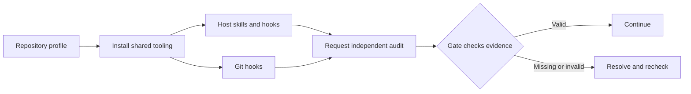

# BoxLite Agent Tooling

## TL;DR

Shared skills, independent audits, and repository gates that help coding agents carry work from design through review across BoxLite repositories.

[Get started](#get-started) · [Add to a repository](#add-to-a-repository) · [Architecture](plugins/boxlite-agent-tooling/ARCHITECTURE.md) · [Contributing](plugins/boxlite-agent-tooling/CONTRIBUTING.md)

## Why use it?

A repository can tell an agent how to work. This toolkit also checks key actions against that workflow: editing, committing, pushing, publishing a PR, and reporting completion.

| You want… | The toolkit provides… |
| --- | --- |
| Consistent engineering practices across repositories | Shared guidance installed into `AGENTS.md`, plus reusable skills |
| Evidence behind an agent's conclusions | Independent auditors for completion claims and commit/push readiness |
| Reviewable changes | Design-document checks, a user choice to bypass or split large PRs, and human review acknowledgments |
| Feedback after a push | A PR watcher for checks, reviews, comments, and merge conflicts |
| Repository-specific verification | A small profile declaring the checks each project needs |

Built for Claude Code and Codex. Copilot has a marketplace entry and generic manifest, but installation on a real host remains untested.

## How it works



The **host plugin** supplies skills, auditors, and lifecycle hooks. The **repository installer** configures Git hooks and shared instructions. Both are needed for the complete workflow; installing a host plugin alone does not configure a repository.

An auditor produces evidence bound to the work it reviewed. Gates read that evidence. For example, changing the staged diff after an audit invalidates its commit approval and requires another audit.

These are local workflow checks, not a sandbox or a GitHub security boundary. Git audit gates recognize harness environment markers and agent processes recorded by PreToolUse; browser writes and other unsupported routes fall outside CLI checks. See [enforcement boundaries](plugins/boxlite-agent-tooling/ARCHITECTURE.md#boundaries).

## Get started

**Already in a configured repository?** From its root, run:

```sh
./.agent-tooling/install.sh
```

You need Bash, Git, `jq`, Perl, Python 3.9+, and the CLI for your host. GitHub operations require authenticated `gh`; declared project checks may need additional tools. First installation needs network access.

| Host | Activate after repository setup |
| --- | --- |
| Claude Code | Trust the repository and its bootstrap hooks. After installation, run `/reload-plugins` or start a new session. |
| Codex | Trust the project `SessionStart` hook, then restart or resume. After installation, start a new task and review plugin hooks with `/hooks`. |
| Copilot | Activation files are supplied; end-to-end installation is unverified. |

The installer updates the managed guidance in `AGENTS.md` and the `CLAUDE.md` import. Review those changes before committing. Background refreshes leave committed instructions alone.

## Add to a repository

A *consumer* is a Git repository that uses this toolkit. Clone this source repository to obtain the files below, then add them to your consumer. Merge settings and hooks where files already exist.

### 1. Declare the project

Create `.agent-tooling/profile.json`. Replace the example repository and test command with your own:

```json
{
  "schemaVersion": 1,
  "profile": "my-project",
  "repository": "your-org/your-repo",
  "tooling": {
    "repository": "boxlite-ai/agent-tooling",
    "ref": "main"
  },
  "checks": [
    { "name": "tests", "command": "npm test" }
  ]
}
```

`tooling.ref` names a branch. `checks` must contain at least one named command. The declared repository must match `origin` when one exists; profiles contain configuration, never credentials.

Add these runtime paths to the consumer's `.gitignore`:

```gitignore
.agents/state/
```

### 2. Add installation and activation files

Paths in the first column are relative to this source checkout; destinations are relative to the consumer root.

| Source | Consumer destination |
| --- | --- |
| [Installer](templates/install.sh) | `.agent-tooling/install.sh` |
| [Codex marketplace](.agents/plugins/marketplace.json) | `.agents/plugins/marketplace.json` |
| [Claude bootstrap script](templates/claude-plugin-bootstrap.sh) | `.agent-tooling/claude-plugin-bootstrap.sh` |
| [Claude bootstrap settings](templates/claude-plugin-bootstrap.json) | Merge into `.claude/settings.json` |
| [Codex bootstrap script](templates/codex-plugin-bootstrap.sh) | `.agent-tooling/codex-plugin-bootstrap.sh` |
| [Codex bootstrap hook](templates/codex-plugin-bootstrap.json) | Merge into `.codex/hooks.json` |
| [Copilot activation settings](.github/copilot/settings.json) | Merge into `.github/copilot/settings.json` |

The profile validator requires activation declarations for all three hosts, even if you use only one. Keep their marketplace refs aligned with `tooling.ref`. Use the canonical Git marketplace source from the templates; local clone registrations conflict across worktrees.

For existing Claude settings, use the supplied merge helper from this checkout, with `consumer` set to the destination repository:

```sh
consumer=/absolute/path/to/your-repo
jq -s -f templates/merge-claude-plugin-settings.jq \
  "$consumer/.claude/settings.json" templates/claude-plugin-bootstrap.json \
  > "$consumer/.claude/settings.json.new" &&
  mv "$consumer/.claude/settings.json.new" "$consumer/.claude/settings.json"
```

For a new settings file, copy the template directly. For existing Codex hooks, append the template's `SessionStart` entry while preserving unrelated hooks.

### 3. Install and activate

From the consumer root:

```sh
chmod +x .agent-tooling/install.sh \
  .agent-tooling/claude-plugin-bootstrap.sh \
  .agent-tooling/codex-plugin-bootstrap.sh
./.agent-tooling/install.sh
git config --worktree --get core.hooksPath
```

The hook path should point into the adopted tooling checkout. Setup assigns the worktree's `core.hooksPath`; inspect existing hook integration before adoption. Commit the consumer files and generated instructions, then activate your host as described above.

## Work with the toolkit

Ask your agent to work normally. Hooks check supported actions as they happen and explain what is needed when a gate blocks progress.

| Task | Entry point |
| --- | --- |
| Research and write a design before coding | Use `boxlite-design-doc`. |
| Implement, refactor, or review maintainability | [boxlite-clean-code](plugins/boxlite-agent-tooling/.agents/skills/boxlite-clean-code/SKILL.md) |
| Review code with Google's engineering practices | [google-code-review](plugins/boxlite-agent-tooling/.agents/skills/google-code-review/SKILL.md) |
| Write or shorten a reply, document, or PR description as structured output | [boxlite-writing](plugins/boxlite-agent-tooling/.agents/skills/boxlite-writing/SKILL.md) |
| Explain a subsystem with a concrete example | “Use `boxlite-examples` to explain how this subsystem works.” |
| Draw a diagram grounded in source | [boxlite-visualize](plugins/boxlite-agent-tooling/.agents/skills/boxlite-visualize/SKILL.md) |
| Highlight essential phrases while preserving meaning | [boxlite-reading-highlights](plugins/boxlite-agent-tooling/.agents/skills/boxlite-reading-highlights/SKILL.md) |
| Extract essential knowledge or a minimal working example | [boxlite-distill](plugins/boxlite-agent-tooling/.agents/skills/boxlite-distill/SKILL.md) |
| Write or review shell scripts, hooks, and gates | [boxlite-shell-engineering](plugins/boxlite-agent-tooling/.agents/skills/boxlite-shell-engineering/SKILL.md) |
| Iterate on design-review findings | [adversarial-iteration](plugins/boxlite-agent-tooling/.agents/skills/adversarial-iteration/SKILL.md) |
| Register a design before implementation | [Design registration](plugins/boxlite-agent-tooling/CONTRIBUTING.md#pull-request-descriptions) |
| Prepare or revise a PR description | [boxlite-pr-preparation](plugins/boxlite-agent-tooling/.agents/skills/boxlite-pr-preparation/SKILL.md) |
| Acknowledge the current PR diff | [Author acknowledgment](plugins/boxlite-agent-tooling/CONTRIBUTING.md#author-review-acknowledgment) |

Skills load by name from the host. Try prompts:

- "Use boxlite-writing to shorten this PR description."
- "Use boxlite-shell-engineering to review this installer for POSIX portability."
- "Use google-code-review to review this diff."
- "Use boxlite-clean-code to review this module's error handling without editing it."
- "Use boxlite-distill to explain this module's core mechanism."

Share whole skill directories, including `references/` and licenses.

After a push, the Git hook starts the PR watcher.

- It reports checks, reviews, comments, and merge conflicts; Codex keeps it alive with a ten-minute schedule, Claude with Monitor.
- Watch intent and pending events survive session replacement; register, acknowledge, and cancel through the [watch lifecycle](plugins/boxlite-agent-tooling/.agents/watch/consumer-lifecycle.md).

For unattended Claude runs, the [network-recovery wrapper](plugins/boxlite-agent-tooling/scripts/resume-on-network-error.sh) retries recorded transient failures within bounded budgets. It requires `claude`, `jq`, `curl`, the failure-recording hook, and a matching `CLAUDE_PROJECT_DIR`.

### Queue follow-up issues

The opt-in [follow-up launcher](plugins/boxlite-agent-tooling/scripts/followups.mjs) gives a managed Claude run a local queue. SessionStart supplies the queue handle and capture rule. Stop can request one more pass to save missed findings and acknowledge their revisions.

Run from the target checkout on macOS or Linux with Node.js 24, Git, and an authenticated operator `gh`. Use a dedicated agent account through noninteractive `sudo`. Give it checkout access, its own Claude credentials, and read-only access to the plugin.

Install Claude Agent SDK `0.3.319` with npm in a dedicated operator-private directory, outside other npm trees. Unset `NODE_PATH`. Give the agent read and execute access to the separate Claude executable.

```sh
node "$plugin_root/scripts/followups.mjs" "$queue_state" "$agent_user" init
node "$plugin_root/scripts/followups.mjs" "$queue_state" "$agent_user" enroll tooling
node "$plugin_root/scripts/followups.mjs" "$queue_state" "$agent_user" run "$sdk_module" "$claude_binary" < prompt.txt
node "$plugin_root/scripts/followups.mjs" "$queue_state" "$agent_user" status
node "$plugin_root/scripts/followups.mjs" "$queue_state" "$agent_user" release "$draft_id"
node "$plugin_root/scripts/followups.mjs" "$queue_state" "$agent_user" drain
```

- Use an operator-private state directory outside the checkout, and absolute SDK and Claude paths.
- Run `init` with the same directory for every linked worktree; the registry binds each clone to one journal, even after a same-filesystem rename.
- A journal in an unsupported format fails and names the re-initialization steps.

`status` shows active drafts and the 50 most recent completed records. Use `history` for completed records, then pass the returned `nextBefore` to `history` for the next page.

`enroll consumer` uses the committed consumer profile and matching origin. `opt-out tooling` or `opt-out consumer` revokes enrollment.

The operator reviews the exact title, body, and destination before authorizing public disclosure. `approve` waits for a verified managed close. `release` records the same approval and explicitly releases the revision.

| Platform | Draft release |
| --- | --- |
| macOS, Claude Code `2.1.319` | The launcher checks final Stop, completed result, SDK stream exhaustion, and clean child exit, since one-shot mode can omit SessionEnd. |
| Linux or other Claude versions | Review and release drafts in the foreground. |
| Windows or unmanaged sessions | File issues manually. |

Use `capture` with JSON on stdin for foreground capture. The fields are `repository`, `operation`, `failure`, `route`, `title`, `body`, and `evidence`.

### Optional prompt reminders

For prompt-only reminders, copy [rule-recency.sh](plugins/boxlite-agent-tooling/.agents/hooks/rule-recency.sh) and its [Markdown companion](plugins/boxlite-agent-tooling/.agents/hooks/rule-recency.md) to the consumer's `.agent-tooling/` directory and use the [Codex](templates/codex-hooks.json) or [Claude](templates/claude-settings.json) template.

- The host must discover `boxlite-writing`; the copied hook references its name without embedding its rules.
- The companion is read on each invocation; missing files remain best effort and do not block prompts.
- Edit the companion to change the reminder.
- Set `consumer` to the destination repository before running the recipe below.

Claude Code needs a **merge**, not a copy — `.claude/settings.json` also carries keys
such as `env`, and overwriting it would drop them:

```sh
mkdir -p "$consumer/.claude"
if [ -f "$consumer/.claude/settings.json" ]; then
  jq -s '
    .[0] as $current | .[1] as $rules |
    ($current * $rules) |
    .hooks.UserPromptSubmit = (
      reduce (
        (($current.hooks.UserPromptSubmit // []) +
         ($rules.hooks.UserPromptSubmit // []))[]
      ) as $entry
        ([]; if index($entry) == null then . + [$entry] else . end)
    )
  ' "$consumer/.claude/settings.json" templates/claude-settings.json \
    > "$consumer/.claude/settings.json.new" &&
    mv "$consumer/.claude/settings.json.new" "$consumer/.claude/settings.json"
else
  cp templates/claude-settings.json "$consumer/.claude/settings.json"
fi
```

## Updates and troubleshooting

Consumers follow the branch in `tooling.ref`. Startup/resume and Git lifecycle events share a 15-minute release check, even when the repository and host plugin have matching versions. The installer validates a fetched revision before adopting it; offline refresh keeps a valid recorded installation.

For example, repository tooling and the installed plugin can both be at 0.1.35 while the branch publishes 0.1.36. The next eligible startup adopts that release and reconciles the current host's plugin. Already loaded sessions still need a reload or a new task.

| Need | Action |
| --- | --- |
| Refresh tooling and shared instructions | Run `./.agent-tooling/install.sh` explicitly. |
| Inspect the adopted revision | Read `agent-tooling/current` under `git rev-parse --git-common-dir`; `agent-tooling/history.log` records adoptions. |
| Pause automatic release checks | Set `AGENT_TOOLING_REFRESH=0`; a mismatched host version then requires explicit repair. `AGENT_TOOLING_REFRESH_MINUTES` sets the interval (0–99999; zero checks every time). |
| Freeze repository tooling | Put one full lowercase commit SHA in `.agent-tooling/hold`, then run the installer. Remove it and reinstall to resume following the branch. |
| Repair missing or stale Git hooks | Rerun the installer; it can repair from an existing valid cache offline. |
| Load newly installed host resources | Reload Claude plugins or start a new Codex task; check hook trust. |
| Resolve a blocked action | Follow the gate's diagnostic; [architecture](plugins/boxlite-agent-tooling/ARCHITECTURE.md#entry-points) maps each gate to its evidence and recovery path. |

A hold constrains repository tooling; it does not silently roll back host plugins. A mismatched host-plugin version fails bootstrap. Disabled plugins stay disabled; installing files does not grant hook trust.

### Upgrade across a breaking release

A breaking release requires re-copying the three `.agent-tooling/*.sh` templates listed above and rerunning `./.agent-tooling/install.sh`.

## Develop and contribute

Reusable implementation lives in [`plugins/boxlite-agent-tooling/`](plugins/boxlite-agent-tooling/). Consumer bootstrap files live in [`templates/`](templates/). Start with the [contributor guide](plugins/boxlite-agent-tooling/CONTRIBUTING.md) and [architecture map](plugins/boxlite-agent-tooling/ARCHITECTURE.md#code-map).

Directory guides: [host hook wiring](plugins/boxlite-agent-tooling/hooks/README.md),
[hook scripts](plugins/boxlite-agent-tooling/.agents/hooks/README.md),
[audit gates and runners](plugins/boxlite-agent-tooling/.agents/hooks/audit/README.md),
[Git hooks](plugins/boxlite-agent-tooling/.githooks/README.md), and
[maintenance scripts](plugins/boxlite-agent-tooling/scripts/README.md).

Validation commands live in [Contributing](plugins/boxlite-agent-tooling/CONTRIBUTING.md#validation).

The optional [GitHub author-review workflow](.github/workflows/author-review.yml) enforces acknowledgments on PRs. Adopt it separately using a reviewed, immutable tooling revision, then require `Author reviewed the PR` in branch rules. Never run PR-head code in that privileged workflow.

## License

[Apache 2.0](LICENSE), except the Google review guide and skill adaptation, which
retain [CC BY 3.0](plugins/boxlite-agent-tooling/.agents/skills/google-code-review/LICENSE).
