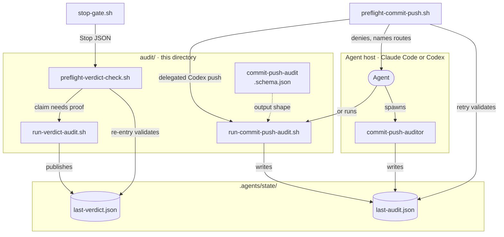

## TL;DR

This directory holds the Stop-stage verdict gate, both headless audit runners, the commit/push dossier schema, and the audit test suites.

## Files

Gates read dossiers; auditors write them. Full contracts: [audit producers](../../../ARCHITECTURE.md#audit-producers).

| File | Called by, with | Result |
| --- | --- | --- |
| [preflight-verdict-check.sh](preflight-verdict-check.sh) | [stop-gate.sh](../stop-gate.sh); `Stop` JSON on stdin | Blocks with findings or allows; consumes the turn dossier. |
| [run-verdict-audit.sh](run-verdict-audit.sh) | The verdict gate, inside the same Stop; `<bookkeeping_path\|-> [session_id] [generation] [session_scope]` | The session's `last-verdict.json`, judged by an independent model CLI. |
| [run-commit-push-audit.sh](run-commit-push-audit.sh) | CI, a plain shell, or an agent on an unidentified host; [preflight-commit-push.sh](../preflight-commit-push.sh) for a delegated Codex push; `<commit\|push> <command>` | `last-audit.json`, the dossier the `commit-push-auditor` subagent also writes. |
| [commit-push-audit.schema.json](commit-push-audit.schema.json) | `codex exec --output-schema` in the commit/push runner | The JSON shape the Codex auditor must answer in. |

## How it works



1. **Turn end.** When the final turn asks the reader to trust a conclusion, the verdict gate runs `run-verdict-audit.sh` inside the same Stop. It then re-enters itself to validate the new dossier: PASS allows silently; FAIL blocks with findings.
2. **Commit or push.** `preflight-commit-push.sh` prepares the history attempt, denies, and names the auditor routes. The agent spawns `commit-push-auditor` or runs the headless runner. `SubagentStop` closes the attempt. The retried command runs only on a fresh, matching PASS, which the gate consumes.

Each dossier is bound to what it judged. A stale turn dossier is discarded; a stale commit/push dossier denies until a fresh audit.
See [bindings](../../../ARCHITECTURE.md#boundaries), [Stop decisions](../../../ARCHITECTURE.md#stop-gate-decisions),
and [state files](../../../ARCHITECTURE.md#state-files).

## Runners

`run-verdict-audit.sh` selects the invoking host's auditor, with the
[boxlite-verdict-audit](../../skills/boxlite-verdict-audit/SKILL.md) as its complete procedure:

1. `VERDICT_AUDITOR_CMD`
2. `hook_host_kind`, shared with native subagent dispatch: Claude Code uses
   `claude -p --safe-mode`; Codex uses read-only `codex exec` with hooks disabled.
3. Unknown hosts retain availability order: Claude, then Codex.
4. No matching CLI: exit 2. A known host never falls through to another provider.

The model task supplies parent session ID, host, repository, request time, and dossier
bindings. The auditor discovers the transcript using the skill's host hints or its own
investigation, verifies parent identity, and revalidates a fixed evidence boundary.
The first runner argument supplies bounded bookkeeping only; `-` marks it unavailable.
For example, a native auditor can receive a parent session ID without any transcript path.
Unknown-host discovery does not change how the independent auditor is launched.

Hook manifests set `BOXLITE_HOOK_HOST` per invocation, overriding inherited values.
This distinguishes Codex's root aliases from nested hosts. Generic hooks set
`unknown`; unmarked legacy callers retain single-root inference. Claude commands
prefer their own plugin root when both roots identify different installations.

The classifier uses the same host detector: Claude Haiku on Claude Code, the default
Codex model on Codex. Unknown hosts retain Claude-or-regex behavior. Explicit
`VERDICT_CLASSIFIER_CMD` overrides selection. Missing or failed classifiers use the
existing regex fallback; a failed auditor remains an audit failure.

Codex classification runs in a private scratch directory, read-only and ephemeral,
with hooks, shell tools, subagents, user config, and project instructions disabled.
Global Codex instructions can still load. Binary discovery and execution share the
existing 20-second capture deadline and 4096-byte output limit. Both Stop stages use
the inert [Codex lookup helper](../../lib/codex-cli.sh), including `CODEX_BIN` and
desktop discovery. For example, installing Claude alongside Codex no longer changes
which provider handles Codex Stop checks.

`run-commit-push-audit.sh` runs `codex exec` read-only with hooks disabled. It rejects an
answer that is malformed or bound to another branch, HEAD, diff, command, or subject.
The commit/push gate prints this command for hosts it cannot identify:

```sh
AUDITOR_SESSION_SCOPE=<scope> AUDITOR_PROMPT_EPOCH=<epoch> CODEX_COMMIT_PUSH_AUDIT_MODE=agentic \
  bash <plugin-root>/.agents/hooks/audit/run-commit-push-audit.sh commit '<target command>'
```

It prints `codex audit commit: PASS` or `FAIL`; findings go to stderr.

| Exit | `run-verdict-audit.sh` | `run-commit-push-audit.sh` |
| --- | --- | --- |
| 0 | Dossier published | PASS dossier written |
| 1 | Audit ran; no valid dossier | FAIL dossier written, including `Internal:` runner failures |
| 2 | Could not start: no runner, bad arguments, a held lock, or history needing recovery | Setup or state-publication error |
| 130 | A newer prompt or INT canceled it | INT |
| 143 | TERM, or the audit lease was lost | TERM |

## Configuration

| Variable | Read by | Default | Effect |
| --- | --- | --- | --- |
| `BOXLITE_HOOK_HOST` | Shared host detector | Legacy root inference | Set by each manifest: `claude`, `codex`, or `unknown`; invalid nonempty exported values yield unknown. Routing metadata only. |
| `VERDICT_AUDITOR_CMD` | `run-verdict-audit.sh` | unset | Replaces the model CLI; reads the audit prompt on stdin and must write the requested dossier. |
| `VERDICT_AUDITOR_MODEL` | `run-verdict-audit.sh` | `claude-sonnet-5` | Model for the `claude -p` route. |
| `VERDICT_AUDITOR_TIMEOUT` | `run-verdict-audit.sh` | `900` seconds | Hard limit for one audit. |
| `COMMIT_PUSH_AUDITOR_TIMEOUT` | `run-commit-push-audit.sh` | `900` seconds | Hard limit for one audit. |
| `CODEX_BIN` | Both runners and Stop classifier | `codex` on `PATH`, then the macOS app bundle | Codex binary; does not override host selection. |
| `CODEX_COMMIT_PUSH_AUDIT_MODE` | `run-commit-push-audit.sh` | `agentic` | `local` runs offline checks, for tests and diagnostics only. |
| `AUDITOR_SESSION_SCOPE`, `AUDITOR_PROMPT_EPOCH` | `run-commit-push-audit.sh` | unset | Bind the audit to one session's history and prompt; the gate's command sets both. |
| `VERDICT_CLASSIFIER_CMD` | `preflight-verdict-check.sh` | Current host's CLI | Replaces triage: turn text on stdin, `YES` or `NO` on stdout. `false` forces the pattern fallback. |
| `VERDICT_EXTRACTOR_CMD` | `preflight-verdict-check.sh` | unset | Reads an unsupported transcript format: `$1` is the path; stdout is the turn text. |
| `VERDICT_GATE_HARD_BLOCK` | `preflight-verdict-check.sh` | `1` | `0` turns blocks into human-only notes, for rollback only. |

## Tests

Run from the repository root, for example:

```sh
bash plugins/boxlite-agent-tooling/.agents/hooks/audit/preflight-verdict-check.test.sh
bash plugins/boxlite-agent-tooling/.agents/hooks/audit/run-commit-push-audit.test.sh
```

| Suite | Covers |
| --- | --- |
| [full-transcript.test.sh](full-transcript.test.sh) | Parent-context handoff without a transcript path, known/unknown hosts, complete evidence access through stubs, bounded history, and cleanup. |
| [preflight-verdict-check.test.sh](preflight-verdict-check.test.sh) | Verdict gate: triage, dossier bindings, consumption, and re-entry. |
| [run-verdict-audit.test.sh](run-verdict-audit.test.sh) | Verdict runner: auditor selection, exit codes, freshness, and cancellation. |
| [stop-host-routing.test.sh](stop-host-routing.test.sh) | Both Stop stages: host selection, overrides, unavailable providers, and bounded Codex discovery. |
| [run-verdict-audit-retry.test.sh](run-verdict-audit-retry.test.sh) | Same-generation retries with history and publication interference. |
| [run-commit-push-audit.test.sh](run-commit-push-audit.test.sh) | Commit/push runner: sandbox flags; malformed or unbound answers land on FAIL. |
| [preflight-commit-push.test.sh](preflight-commit-push.test.sh) | [../preflight-commit-push.sh](../preflight-commit-push.sh): command matching and dossier checks. |
| [commit-push-attempt.test.sh](commit-push-attempt.test.sh) | Hook-prepared commit/push attempts and the `SubagentStop` check that closes them. |
| [cancel-verdict-audit.test.sh](cancel-verdict-audit.test.sh) | [../cancel-verdict-audit.sh](../cancel-verdict-audit.sh): a new prompt cancels the session's audit. |
| [auditor-override.test.sh](auditor-override.test.sh) | [../auditor-control.sh](../auditor-control.sh): auditor escalation and prompt-scoped overrides. |
| [record-test-run.test.sh](record-test-run.test.sh) | [../record-test-run.sh](../record-test-run.sh): which commands leave test-run receipts. |

The runner suites stub model CLIs; see [auditor test isolation](../../../CONTRIBUTING.md#auditor-test-isolation).
