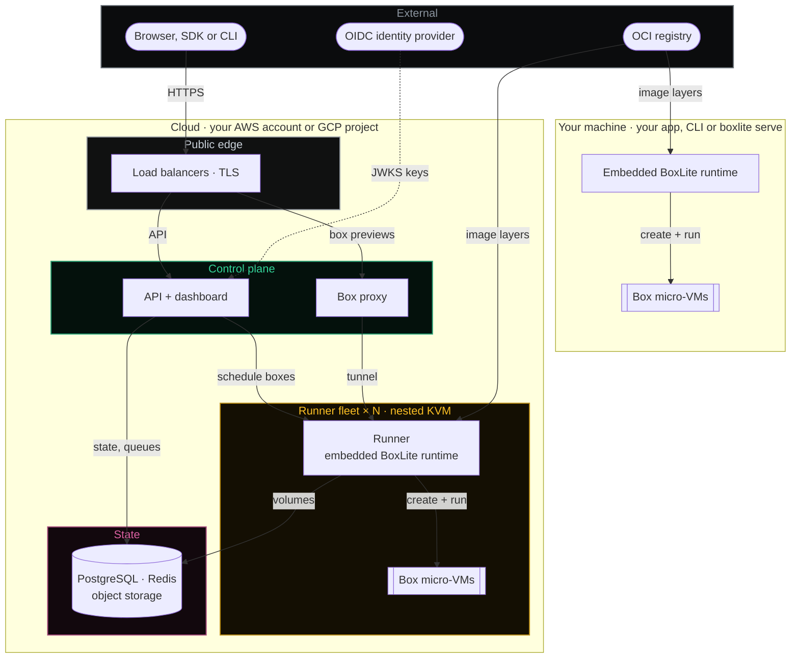
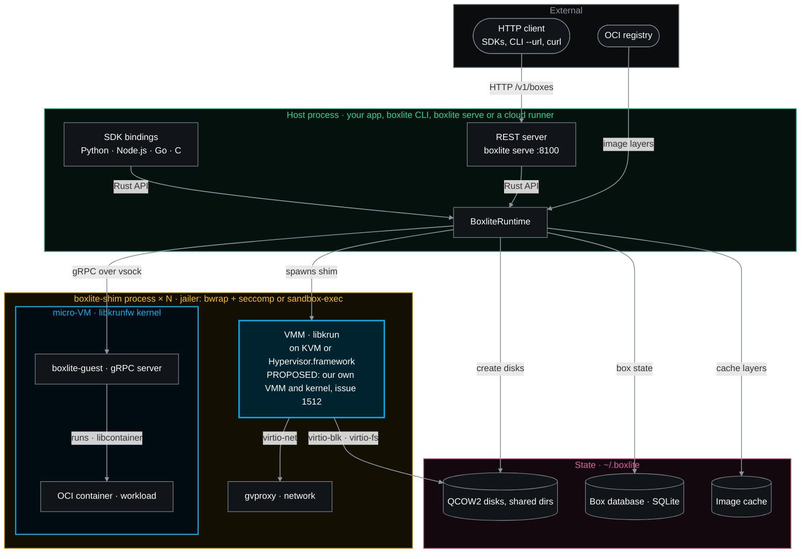

## Architecture

### Current

<code>overview</code> — How one BoxLite engine runs boxes on your machine and in your own cloud

<code>local_machine</code> — How the BoxLite engine on your machine turns a call into a container in its own micro-VM

