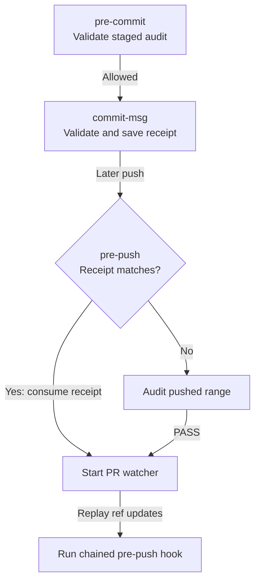

## TL;DR

Git hooks verify installation, gate agent commits and pushes, and keep consumer tooling synchronized across Git lifecycle events.

## Installation and scope

The consumer's `./.agent-tooling/install.sh` calls [setup.sh](../scripts/setup.sh),
which sets worktree-local `core.hooksPath` to this directory. Inspect it with
`git config --worktree --get core.hooksPath` from the consumer checkout.

Installation and guidance checks on commit/push, chained hooks, and watcher setup also run for humans.
These local hooks are workflow checks, not a security sandbox.

## Git gates

[`.agents/lib/git-agent-origin.sh`](../.agents/lib/git-agent-origin.sh) activates audits for nonempty `CLAUDECODE`, `CODEX_SANDBOX`, or `AGENT_GATED`, or for a recorded live ancestor. Unrelated human terminals remain exempt.

Markerless manifests retain `; exit $?` and `--launcher-pid "$$"`; PreToolUse validates its parent, then records launcher-parent PID/start token in `agent-tooling-agent-shells/<PID>`.

- Missing metadata/lookups/writes or stale installed hooks block delegation; custom wiring must preserve the launcher.
- Check at most 64 ancestors; malformed/unreadable consulted records deny; owners cannot overwrite each other or match reused PIDs.
- Records activate audits and still require a matching dossier or receipt. Records survive consumption and stop matching after owner exit.
- Reload updated host hooks to pick up markerless launcher wiring.

Audit state lives only in `.agents/state/`. A leftover `.claude/.last-audit.json` or `.claude/.last-audit-handoff.json` blocks agent commits and pushes; the denial names the exact `rm -f` command.

## Hooks

| Hook | Input | Behavior |
| --- | --- | --- |
| [`.githooks/pre-commit`](pre-commit) | Git invokes without arguments. | Run `scripts/verify-installation.sh`, verify guidance, run the existing hook, then validate the final staged index against the agent's audit. |
| [`.githooks/commit-msg`](commit-msg) | Commit-message file path. | Run the existing hook; validate the audited subject and staged content, publish a commit receipt, and consume audit state. |
| [`.githooks/pre-push`](pre-push) | Remote name/URL; ref updates on stdin. | Verify installation/guidance; audit pushed content or consume a matching receipt, start watchers, then replay input to the existing hook. |
| [`.githooks/post-checkout`](post-checkout) | Previous/new HEAD and checkout flag. | Run `scripts/sync-installation.sh`, then forward arguments to the existing hook. |
| [`.githooks/post-merge`](post-merge) | Squash flag. | Run `scripts/sync-installation.sh`, then forward arguments to the existing hook. |
| [`.githooks/post-rewrite`](post-rewrite) | Rewrite command; old/new commit pairs on stdin. | Preserve stdin, synchronize installation, then replay the pairs and arguments to the existing hook. |

The hooks share [hook-lib.sh](hook-lib.sh): the delegated-gate call and the sync-then-chain step.
Each hook runs the gate from its own plugin copy; a missing gate blocks agent commits and pushes.

Existing hooks are resolved beneath `git rev-parse --git-common-dir` in `hooks/`;
this avoids resolving `core.hooksPath` back to the same hook. A chained hook's
failure propagates. Lifecycle synchronization is best effort; commit/push
installation verification fails closed.

## How it works

For an agent committing and pushing one change:



Installation and guidance checks run before commit/push audit enforcement.
A failed audit blocks the operation; a receipt only covers a push introducing
exactly the audited commit, matching its parent, tree, and subject. After the
chained hook succeeds (or is absent), the push may proceed.

`pre-push` starts the watcher before transfer; the watcher waits for the commit and PR to appear remotely.

- Watcher startup is best effort and also applies to human pushes.
- `BOXLITE_PR_WATCH=0` disables startup.
- See [watch delivery](../.agents/watch/consumer-lifecycle.md) and [Git audit attempts](../.agents/hooks/audit/architecture.md#commitpush-attempts).

Existing refs use advertised old SHA; new refs choose the nearest merge-base among destination remote-tracking refs by outgoing commit distance.

For `main → stack-1 → stack-2`, pushed `stack-1` becomes the base; no ancestor means full history/empty-tree diff; stale refs/merges limit precision.

### Published-main merges

One existing branch fast-forward ending in a two-parent merge can use scoped evidence when stock GitHub HTTPS proves the imported history is published.
The optional query uses Git's noninteractive credentials and the exact `git-receive-pack` discovery service, verified TLS, and no redirects.
Unsupported transports, custom transport configuration, unavailable credentials, ambiguous ancestry, or mixed updates retain the original endpoint evidence.

For feature F merging published main P into N, the reviewer sees unpublished ordinary patches and selected F→N and P→N patches.
Select every path both parents changed and every result differing from the expected inherited entry.
Each selected path includes its reason and base/parent/result entries, including overlaps with two empty patches.

| Preserved contract | Enforcement |
| --- | --- |
| Complete operation | Original ref headers, destination binding, subjects, endpoint SHA-256, and full endpoint path manifest. |
| Local checks | Per-ref API checks and complete endpoint token, review-marker, and subject checks finish before substitution. |
| Metadata independence | Private Git metadata borrows objects read-only; grafts, replacements, commit graphs, consumer attributes, and external transformations cannot change proof reads. |
| Bounds | One ten-second proof/render deadline; 256-KiB receive response, 16-MiB aggregate tree staging, at most 128 ordinary commits. |
| Evidence publication | Both raw scoped output and its complete sanitized rendering must fit 256 KiB; private staging replaces endpoint evidence only after success. |
| Cleanup | The existing process owner terminates descendants; POSIX controller cleanup allows up to four additional seconds. |

`scripts/push-merge-evidence.py` owns optional proof and rendering.
`.agents/lib/commit-push-evidence.sh` shares full-source checks and sanitized push formatting between the hook and headless auditor.
The synthetic push command hashes the selected artifact; its endpoint hash binds the complete source that preceded selection.

## Tests

Run from the repository root:

```sh
bash plugins/boxlite-agent-tooling/tests/git/githooks.test.sh
bash plugins/boxlite-agent-tooling/tests/git/lifecycle.test.sh
bash plugins/boxlite-agent-tooling/tests/git/push-merge-evidence.test.sh
```

The first suite covers gates, receipts, chaining, and push input; the second covers
installation synchronization during checkout, merge, and rewrite.
