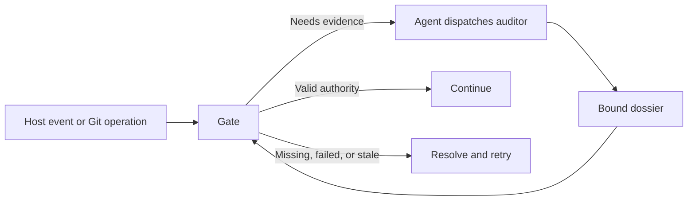

# Architecture

## TL;DR

Local gates for Claude Code, Codex, and generic Copilot validate bound evidence from independent auditors before allowing supported actions.

## Entry points

Host manifests: `hooks/hooks.json` (Claude), `hooks/codex-hooks.json` (Codex), and `hooks/generic-hooks.json` (Codex events, unknown host).

| Event | Script | Contract |
| --- | --- | --- |
| `UserPromptSubmit` | `.agents/hooks/cancel-verdict-audit.sh` | Record typed PR replies and revoke old authority. Unchanged audit work may finish as prior evidence. |
| Typed design decision | `.agents/hooks/design-decision-prompt.sh` | Record a reply bound to the current request and session. |
| Opt-in `UserPromptSubmit` | `.agents/hooks/rule-recency.sh` | Reference workflow and writing skill; absent from plugin manifests. |
| `SubagentStart`, `SubagentStop` | `.agents/hooks/auditor-control.sh` | Track workers, escalation, completion, overrides, and Git attempt closure. |
| Auditor/advisor start, tool, stop | `.agents/hooks/audit-deadline.sh` | Publish native dossier-worker ownership, enforce deadlines, and clean up owned tasks. |
| Design auditor/advisor tools | `.agents/hooks/audit-privacy.sh` | Reject recognizable personal identifiers and key requests; see [privacy limits](docs/design-and-pr-gates.md#audit-rule-ownership). |
| Exact design-run Bash action | `.agents/hooks/preflight-design-worker.sh` | Own fresh CLI launch, broker, bounded collection, and publication; timeout 10,120 seconds. |
| Editor, notebook, patch `PreToolUse` | `.agents/hooks/preflight-design-doc.sh` | Require current design authority, with exceptions for outside targets and [owned auditor reports](docs/design-and-pr-gates.md#auditor-report-writes). |
| Commit/push `PreToolUse` | `.agents/hooks/preflight-commit-push.sh` | Delegate to installed Git gates; deny with an explicit next action. A leftover `.claude/.last-audit*.json` blocks agent commits and pushes; the denial names the `rm` command. Until 0.1.55, the gate removes a regular copy identical to its `.agents/state/` original, which a 0.1.53 session writes on every attempt (#489). |
| GitHub/PR shell `PreToolUse` | `.agents/hooks/preflight-pr-review.sh` | Check writing, privacy, design, description, size, and human review acknowledgment. |
| PR body file | `scripts/gh-pr.sh` | Run the same PR checks and publish the checked snapshot over stdin. |
| Issue, comment, review, and release text file | `scripts/gh-write.sh` | Apply GitHub writing checks to a bounded snapshot and pass it over stdin. |
| Remote-write `PostToolUse` | `.agents/hooks/post-remote-write-watch.sh` | Attach successful writes to PR monitoring. |
| Test `PostToolUse`; Claude failure event | `.agents/hooks/record-test-run.sh` | Record supported completed `make test...` results in ignored test-run receipts. |
| `Stop` | `.agents/hooks/stop-gate.sh` | Continue timed requests, check writing, then execute verdict checking. A payload without a non-empty `session_id` blocks. |
| Claude `StopFailure` | `.agents/hooks/record-api-failure.sh` | Record failure kind for `scripts/resume-on-network-error.sh`. |
| Claude async `StopFailure` | `.agents/hooks/resume-after-api-failure.sh` | Resume eligible interactive failures at most three times per session in ten minutes. |

## Subsystem references

| Need | Reference |
| --- | --- |
| Understand design and PR decisions | [Design and PR gates](docs/design-and-pr-gates.md) |
| Trace a commit or push | [Git hooks](.githooks/README.md#git-gates) and [audit routes](.agents/hooks/audit/architecture.md#audit-producers) |
| Diagnose a blocked final reply | [Stop gate decisions](.agents/hooks/audit/architecture.md#stop-gate-decisions) and [audit state](.agents/hooks/audit/state.md#state-files) |
| Check response authority or writing limits | [Timed confirmations](docs/timed-confirmations.md) and [writing checks](docs/writing-checks.md) |
| Inspect PR watch delivery | [Watcher lifecycle](.agents/watch/consumer-lifecycle.md#producer-and-delivery-contracts) |
| Maintain installation or check API changes | [Installation runtime](scripts/README.md#installation-runtime) and [API compatibility](scripts/api-compatibility.md#api-compatibility) |

### Commit/push attempts

See [attempt ownership and next actions](.agents/hooks/audit/architecture.md#commitpush-attempts).

### Timed subagents

See [auditor deadlines and recording windows](.agents/hooks/audit/architecture.md#timed-subagents).

### Audit progress

History inspection for commit, push, and verdict, plus design status, uses `.agents/lib/audit-loop.jq` for read-only classification.
For example, two ERROR rounds report `infra` while the existing reflection and permission checks still apply.
See [progress diagnostics](.agents/hooks/audit/state.md#progress-diagnostics) for severity, legacy records, bounds, and reconstruction limits.

## Follow-up capture

The optional Claude launcher injects the queue rule and handle through SessionStart. The SDK binds queue calls to the native root, prompt, and Git common directory. A PreToolUse callback inserts a one-use permit after checking that binding.

The capture callback waits for the installed Stop gate to allow the turn. It can ask once per prompt for an exact draft acknowledgment, including an empty set. A later tool call or model turn invalidates the seal.

- The operator stores clone-keyed SQLite state outside the checkout, beyond the agent account's access.
- An operator-owned registry binds each clone to one journal across linked worktrees and same-filesystem renames.
- Finished drafts leave the active queue and keep deduplication records; status and history read at most 50 completed records per page.

The queue lock covers archive writes. A journal in an unsupported format fails closed and names the re-initialization steps.

The operator checks the private SDK installation before loading any of its code. Startup reclaims abandoned handles when their recorded owner process has exited. The active draft size limit leaves room for approvals, close evidence, and retry state.

- The qualified macOS one-shot launcher requires an allowed final Stop, a completed root result, SDK stream exhaustion, and clean child exit.
- If Claude omits SessionEnd, the launcher records the close after observing those signals.
- The root result starts one deadline for SDK exhaustion and child closure; a timeout forces teardown and holds the drafts.

Enrollment pins a GitHub repository ID. The operator grants public disclosure for the exact revision and destination, including the embedded marker. A clone lock spans the durable attempt and the single create request.

- After an ambiguous create, drains search the original repository's open and closed issues for the recorded author and marker; unmatched sweeps never create again.
- Drains resume after the last serviced draft and reduce oversized pages at the same cursor.
- Each drain allows 30 seconds, 10 requests, and up to five seconds per request.

## Boundaries

Local gates are workflow checks; unsupported routes and writable state prevent sandbox/server-policy guarantees.

| Boundary | Contract |
| --- | --- |
| Host to hook | `BOXLITE_HOOK_HOST` declares routing only. Claude prefers `CLAUDE_PLUGIN_ROOT`, Codex and generic prefer `PLUGIN_ROOT`, and both fall back to the alternate root. Session markers do not route. Codex may export both aliases. Generic identity stays unknown. |
| Hook to agent | Dossier audits use parent dispatch through `.agents/lib/subagent.sh`; the fixed design action launches fresh CLI workers inside the host hook. |
| Agent to auditor | Dossier auditors write their reports; design workers return JSON on an owned channel. Gates validate publication without authoring judgments. |

### Gate to state

| Artifact | Binding / mismatch behavior |
| --- | --- |
| Turn dossier | Branch, HEAD, tree, generation, session, epoch; stale/mismatched evidence discards into fresh detection. |
| Commit/push dossier | Branch, HEAD, staged/pushed diff, command, commit subject; five-hour validity; mismatch/age denies. |
| Receipt | Parent, tree, subject; never diff hash alone. |
| Design verdict | Root, branch, URL, live-content SHA-256; automatic results require worker provenance and advice bound to the verdict task. Human overrules retain their content binding. |
| Timed PR request | Review and size bindings survive explicit renewal; archive the prior attempt before publishing a fresh pending ID and deadline. Renewal grants no approval. |

## Invariants

| Authority | Invariant / owner |
| --- | --- |
| Verdict | Gates never author verdicts; consumed PASS/advisories stay out of model input; advisories reach humans only. |
| Turn | Never judge a message twice; stale/parked evidence cannot approve later claims; incomplete refresh cannot erase failure. |
| Design | Editor/patch edits require live PASS plus advice or human overrule; only authenticated reply routes record choices. |
| Git | Humans remain exempt; receipts bind parent/tree; session/plugin version disagreement requires reload. |
| Retry | Timeouts permit reflected review, never approval; preserve failed cycles and candidate-bound execution proof. |
| Override | `.agents/lib/auditor-override-state.sh` records `OVERRIDDEN BY USER`, never PASS, prompt-scoped and ≤1 hour. |
| Host/config | Closed Codex event set; declared host/root precedence; invalid hold denies; `.agents/state/` stays ignored. |

The [result ownership contract](docs/design-and-pr-gates.md#result-ownership) binds fresh design workers to exact snapshots and serializes their results with human decisions.

## Glossary

- **dossier**: auditor's bound JSON verdict.
- **generation**: audit request identity; revised claims require a fresh one.
- **session scope**: suffix separating sessions sharing a checkout.
- **prompt epoch**: counter revoking old authority on real user input.
- **rung**: logged Stop decision stage.
- **triage**: model/regex decision whether claims need proof.
- **marker**: typed, bound, consumable local PR acknowledgment.

### Authorization terms

- **receipt**: parent/tree/subject-bound commit approval spent by push.
- **override**: prompt-scoped bypass recorded as user override.
- **revoke**: invalidate older prompt authority.
- **parked**: failed dossier retained for fresh review.
- **stale**: binding/age mismatch; discard turn evidence, deny Git approval.
- **blind-allow**: finish unjudged when transcript lacks assistant text.

### Installation and watcher terms

- **hold**: full lowercase SHA freezing adoption.
- **tooling.ref**: configured floating source; current records adopted revision.
- **guidance block**: hash-marked workflow; missing/edited denies, behind warns.
- **twins**: normalized Claude/Codex manifests; generic shares Codex events with unknown identity.
- **watch**: one post-push JSON event stream/run ID.
- **wake**: async host turn authenticated by an unspent nonce.
- **author review acknowledgment**: PR author's new unedited SHA comment.

## Code map

| Location | Owner |
| --- | --- |
| [hooks/](hooks/README.md) | Host manifests. |
| [.agents/hooks/](.agents/hooks/README.md), [audit/](.agents/hooks/audit/README.md) | Stable lifecycle hooks, shared helpers, and audit runners. |
| `.agents/lib/` | Sourced state, host, receipt, rendering, and dispatch libraries; see [shared libraries](#shared-libraries). |
| [`.agents/prompts/`](PROMPTS.md#runtime-contracts) | Runtime Markdown templates. |
| `.agents/watch/` | Producer, durable intent, pending delivery, consumers. |
| `.agents/skills/`, `.claude/agents/` | Complete skills and native auditor/advisor specs. |
| [.githooks/](.githooks/README.md), [scripts/](scripts/README.md) | Git gates and maintenance commands. |
| `guidance/workflow.md` | Consumer policy. |
| [`tests/`](tests/), `tests/host-parity.test.sh`, `tests/architecture.test.sh` | Plugin suites by subsystem, asset parity, map coverage. |

Entry paths stay stable. Runtime helpers live in subsystem directories. Tests resolve implementation paths from the plugin root.

Claude/Copilot use `skills` and `agents` aliases. Host parity checks Codex's canonical paths in symlink-free cache copies.

### Design worker implementation

| Module | Responsibility |
| --- | --- |
| `.agents/hooks/design-worker-state.sh` | Private snapshot, assignment, human acceptance, and publication transitions under the clone transaction. |
| `.agents/hooks/design-worker-group.sh` | POSIX leader adapter over the shared in-group controller. |
| `scripts/design-worker.py` | Exact snapshot identities, installed profiles, canonical tasks, native result parsing, and setup/review supervisors. |
| `scripts/design-worker-broker.py` | Typed read-only source/history/cache tools, isolated public prefetch, and 32 MiB current/64 MiB combined source ceilings. |
| `scripts/design-worker-process.py` | Separate POSIX lifetimes and suspended Windows Job Object assignment. |
| `.agents/design-worker-policy.json` | Installed CLI versions and models; optional qualified administrative paths and provider settings. |

### Shared libraries

| Library | Used by | Owns |
| --- | --- | --- |
| `.agents/lib/tooling-profile.sh` | Installer, refresh, verification, profile validation, host bootstraps | Profile `tooling` fields and hold policy; callers report its error. |
| `.agents/lib/shell-scan.sh` | `.agents/hooks/preflight-pr-review.sh`, `.agents/hooks/preflight-design-worker.sh` | Splits shell source into simple commands without running it. |
| `.agents/lib/pr-watch-attachment.jq` | `.agents/hooks/post-remote-write-watch.sh`, `.agents/watch/pr-watch-attach.sh` | Pre-push attachment manifest schema. |
| `.githooks/hook-lib.sh` | Git hooks | Delegated commit/push gate call and the sync-then-chain step. |
| `.agents/lib/commit-push-evidence.sh` | Pre-push and headless commit/push auditor | Complete-source checks and identical sanitized push rendering; see [published-main merges](.githooks/README.md#published-main-merges). |

`scripts/push-merge-evidence.py --publish` owns optional receiving-service proof, committed-tree evidence, shared sanitized rendering, and atomic endpoint replacement under one deadline and process lifetime.
Private staging shares the endpoint filesystem; rendering failure or timeout preserves the endpoint and terminates owned descendants.
The pre-push hook retains complete endpoint source through local checks; publication requires complete scoped output within both raw and sanitized limits.
The helper excludes Git's inherited helper directory from executable lookup before launching its owner, then validates the exact default within the owned deadline.
Git, curl, Bash, proof subprocesses, and sanitized rendering share the restored search path; custom or ambiguous helper selections preserve endpoint evidence.

### Skill ownership

| Skill | Owns |
| --- | --- |
| `boxlite-writing`, `boxlite-pr-preparation` | Writing policy; inspect/illustrate/write/verify PR preparation, with core tables inline. |
| `boxlite-design-doc` | Research, options, outline, pre-code gate; complex sources use distill without dropping evidence. |
| `boxlite-clean-code`, `google-code-review` | Coding/refactoring principles and repository-subordinate attributed review guidance. |
| `boxlite-shell-engineering` | Shell I/O, portability, state, verification; topic-indexed complete licensed references. |
| `boxlite-reading-highlights` | Exact selection, reversible browser marks; cache requires matching live text/fingerprints/settings, never automatic replay. |
| `boxlite-distill` | Knowledge/minimal implementation scope, removal test, fidelity, execution, reader sufficiency, evidence results. |
| `boxlite-visualize` | Source-grounded `diagram.md`/`evidence.json`; render/fit/trace validation in `validation.json`, then visual inspection. |

Share whole skill directories, including references. Skill discovery adds no publication authority; [instruction owners](CONTRIBUTING.md#instruction-ownership) keep policies and checkers.
