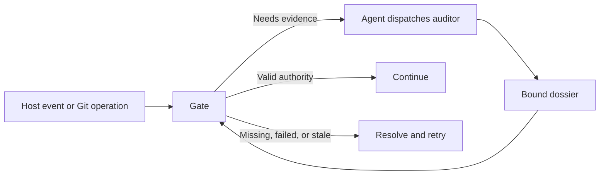

# Architecture

## TL;DR

One plugin serves Claude Code, Codex, and generic Copilot consumers; independent auditors produce bound evidence that local gates validate before allowing supported actions.

## Entry points

Host manifests: `hooks/hooks.json` (Claude), `hooks/codex-hooks.json` (Codex), and `hooks/generic-hooks.json` (Codex events, unknown host).

| Event | Script | Contract |
| --- | --- | --- |
| `UserPromptSubmit` | `.agents/hooks/cancel-verdict-audit.sh` | Revoke old authority; unchanged audit work may finish as prior evidence. |
| Opt-in `UserPromptSubmit` | `.agents/hooks/rule-recency.sh` | Reference workflow and writing skill; absent from plugin manifests. |
| `SubagentStart`, `SubagentStop` | `.agents/hooks/auditor-control.sh` | Track workers, escalation, completion, overrides, and Git attempt closure. |
| Auditor/advisor start, tool, stop | `.agents/hooks/audit-deadline.sh` | Publish native dossier-worker ownership, enforce deadlines, and clean up owned tasks. |
| Design auditor/advisor tools | `.agents/hooks/audit-privacy.sh` | Reject recognizable personal identifiers and key requests; see limits below. |
| Editor, notebook, patch `PreToolUse` | `.agents/hooks/preflight-design-doc.sh` | Require current design authority, with exceptions for outside targets and [owned auditor reports](#auditor-report-writes). |
| Commit/push `PreToolUse` | `.agents/hooks/preflight-commit-push.sh` | Delegate to installed Git gates; deny with an explicit next action. |
| GitHub/PR shell `PreToolUse` | `.agents/hooks/preflight-pr-review.sh` | Check writing, privacy, design, description, size, and human review acknowledgment. |
| Claude question pre/post tool | `.agents/hooks/claude-timed-question.sh` | Validate managed presentation and timely answers; expiry grants no authority. |
| Remote-write `PostToolUse` | `.agents/hooks/post-remote-write-watch.sh` | Attach successful writes to PR monitoring. |
| Test `PostToolUse`; Claude failure event | `.agents/hooks/record-test-run.sh` | Record supported completed `make test...` results in ignored test-run receipts. |
| `Stop` | `.agents/hooks/stop-gate.sh` | Continue timed requests, check TL;DR once, then execute verdict checking. |
| Claude `StopFailure` | `.agents/hooks/record-api-failure.sh` | Record failure kind for `scripts/resume-on-network-error.sh`. |
| Claude async `StopFailure` | `.agents/hooks/resume-after-api-failure.sh` | Resume eligible interactive failures at most three times per session in ten minutes. |

Entry paths stay stable; helpers/tests use `audit`, `design`, `pr`, `resume`, `session`, and `watch` subdirectories, resolved from the plugin root.

### Runtime prompts

[PROMPTS.md](PROMPTS.md) owns template locations and editing contracts.

Templates use qualified purpose/name lookup under `.agents/prompts/`; no basename search, implicit Markdown inlining, or embedded Bash fallback.

- Missing/empty/unresolved templates block partial dispatch, acknowledgment consumption, and publication; callers explicitly require skill loading.
- Watch variants retain 1400-byte bounds/exact claim commands; failure leaves authority with the lease owner; acknowledgment recovery stays within 1200 bytes.
- Resume prompts load before wake-budget recording; `.agents/prompts/questions/interactive-question.md` renders validated questions with option commands kept as generated JSON.
- Standalone reminders copy `.agents/hooks/rule-recency.sh` and `.agents/hooks/rule-recency.md` together without plugin libraries.

## Gates

### Design documents

Policy: `boxlite-design-doc`; commands: [Contributing](CONTRIBUTING.md#pull-request-descriptions); outline: [design issue template](../../.github/ISSUE_TEMPLATE/design.md).

`scripts/design-doc.sh` delegates provider reads and binding to `.agents/lib/design-doc.sh`.

| Record in worktree Git directory | Binding / validation |
| --- | --- |
| `agent-tooling-design-doc.json` | Canonical root, branch/detached HEAD, readable nonempty provider content, leading TL;DR under 40 words. |
| `agent-tooling-design-audit.json` | Root, branch, URL, live-content SHA-256, PASS or human overrule. |
| `agent-tooling-design-advice.json` | Fresh advice bound to the FAIL attempt or PASSed content; overrules need none. |
| `agent-tooling-design-audit-task.json` | Fixed deadline per design content; `DESIGN_AUDITOR_TIMEOUT`, default 900 seconds. |
| `agent-tooling-design-advice-task.json` | Advisor deadline using the same timeout. |

`register`/`bind` share validation; `verdict`/`research` share recording, and legacy `agent-tooling-design-research.json` remains readable until replacement.

- `.agents/lib/verdict-audit-state.sh` supplies safe reads/replacement; failed reads retain no success cache.
- Notion child blocks fail closed; native block structure prevents literal text forging headings; design length has no total-word cap.
- Missing/stale authority names the auditor route; fresh PASS also waits for advice; changed content requires review again.
- The auditor reads through `show`, then records one live `{content_sha256, verdict, findings, advisories}` object.
- Critical/high gaps FAIL; low/nit gaps remain advisory; every round checks the complete design skill and outline.

The research log stays out of the design, which is for human reviewers ([design #388](https://github.com/boxlite-ai/agent-tooling/issues/388)):

| Part | Behavior |
| --- | --- |
| Store | `design-doc.sh log` stores stdin (≤32,000 characters) as `{id, log}` in `agent-tooling-design-log/<sha256 of design ID>.json` under the clone's common directory (Git 2.31+). Normalized IDs (GitHub `owner/repo#N` lowercase, Linear uppercase, Notion lowercase without dashes) let URL spellings, worktrees, and re-registration share one log; removing a worktree keeps it. |
| Write | Empty input tombstones the log; records are replaced atomically, never removed, and read only as bounded regular files; a failed write keeps the stored log. |
| Hash | With no log ever stored, the bound SHA-256 is the provider body's; otherwise it hashes `agent-tooling-design-log-v1`, the body hash, and the log hash, one per line, so any log change needs a new audit in every bound worktree. |
| Show | `design-doc.sh show` appends `## Research log (local)`, the log's `sha256:` line, and the log; advice anchors resolve against that text. The log is never published; deleting the clone loses it. |
| Template | The design and [issue template](../../.github/ISSUE_TEMPLATE/design.md) stay tool-free; the skill and audit prompts own the research protocol. |

#### Audit rule ownership

Specs own input/output; `design-criteria.md` owns steps/entry format (2048-byte cap); `design-outline.md` owns whole-design checks; tasks own deadlines and untrusted-record framing.

How it works must open with a one-line overview and a concrete example before the mechanism ([design #418](https://github.com/boxlite-ai/agent-tooling/issues/418)). No overview, or no example before the mechanism, is high; other readability gaps, such as an undefined project-specific term, are low; mechanism and trade-off gaps keep their usual severity.

Related work must open with a best-practice line, sourced or “none established” with evidence, then group cited approaches in one table with the design’s pick row marked Pick, and list failures, constraints and counterevidence under Lessons ([design #424](https://github.com/boxlite-ai/agent-tooling/issues/424)). A missing line or approach grouping is high.

`probe-privacy.md` repeats deliberately in both specs; privacy hooks detect addresses/key requests, with address-only WebSearch checks.

Expansion, encoding, file-backed payloads, and Codex-hosted WebSearch bypass the heuristic; [probe policy](.agents/prompts/audit/probe-privacy.md) remains mandatory.

#### Design advice

Each live PASS/FAIL needs fresh advice after required stop/reflection handling: ≤5 single-line items, ≤500 characters each, `Why:` evidence before `Try:`.

Reject severity labels/unresolved local anchors; outside evidence remains unchecked; advice never mutates verdicts or enters `prior_findings`.

#### Design audit loop

`.agents/lib/design-audit.jq` counts FAILs per root/branch across rebinding; PASS, overrule, or redesign resets the count.

| Condition / choice | Result |
| --- | --- |
| Edited content, same URL | Carry last FAIL's findings into the next task. |
| Converging second FAIL | Require reflection matching `.agents/lib/audit-reflection-contract.jq`. |
| Repeated/non-reducing second FAIL, third FAIL, or FAIL after reflection choice | Stop as INCOMPLETE and ask for a human decision. |
| Redesign | Reset count; failed content cannot be audited again. |
| Reflect again | Require reflection, then permit one more audit. |
| Overrule | Record `OVERRIDDEN`; retained `overruled:` findings are not re-raised. |
| No answer after five minutes | Keep edits blocked. |

Only managed question hooks, correlated Codex replies, or a human's first-line `design-decision: <choice> <reason>` record decisions.

Neither design agent has a force-pass card; they gate edits, not turn completion or commits.

#### Design conformance

Commit/push criteria compare the diff with authenticated `design-doc.sh show` output; they do not repeat design auditing.

- Linear/Notion reads need no browser login; `show [repo-root]` supports writable scratch with authoritative target binding.
- Substantive project documentation remains required for every PR; reviewers assess quality, and the design gate does not inspect documentation diffs.

#### Editor scope

`.agents/lib/edit-scope.sh` exempts only targets outside every worktree/Git directory at both named and symlink-resolved locations.

- A directory without `.git` counts as outside; relative cwd, `~`, dot segments, dangling links, or unparseable targets retain the gate.
- Shell commands, other clients, and arbitrary MCP writers remain outside this hook; workflow design requirements still apply.
- Shell execution retains host permissions and independent Git/PR checks; no research-command allowlist applies.

##### Auditor report writes

The design gate allows a native commit/push or verdict auditor to save its assigned report through `Write` or a single-file add/update patch. [Design #406](https://github.com/boxlite-ai/agent-tooling/issues/406)

- `.agents/lib/audit-report-scope.sh` checks the repository, session, worker, open attempt, and current prompt epoch or verdict request before allowing the exact report path.
- Aliases, links, special files, other reports, and unrelated agents still require design authority, as do deletes, moves, and mixed patches.
- The synchronous deadline Start publishes ownership through `auditor-control.sh publish-start`; asynchronous `monitor-start` only observes that ownership.
- The deadline still ends investigation, and Stop validates and records the report as PASS, FAIL, or an execution error.

#### PR description structure

`.agents/lib/pr-description.sh` checks create/edit/ready operations, drafts included, before acknowledgment handling.

| Requirement | Contract |
| --- | --- |
| Design link | Rendered anchor outside code exactly targets the registered canonical URL. |
| Preserved body | Fetch published text and match branch/HEAD, including metadata-only edits. |
| Explanation | Rendered level-two **How it works** has content before the next peer/higher heading. |
| Accepted content | Prose, lists, tables, diagrams; any independently qualifying matching section suffices. |
| Rejected content | Nested headings alone, quotes, comments, example headings, or placeholder-only/mixed placeholders. |
| Render bounds | 20 seconds, 64 KiB; failure blocks publication without consuming acknowledgment. |

Hidden source URLs do not count; direct API/browser writes bypass this CLI boundary; example accuracy and relevance remain human review responsibilities.

### GitHub writing

`.agents/lib/github-writing.sh` checks recognized `gh` PR/issue/discussion bodies, comments, reviews, close/reopen text, release notes, and REST body/description fields.

| Check | Contract |
| --- | --- |
| Structure | Every inspected body keeps the [structure limits](#structure-limits), TL;DR or not; one denial lists summary and structure fixes. |
| Summary | Inspected bodies need ≤39-word TL;DR; comments, reviews, and close/reopen text ≤80 words are exempt. |
| Counting | Unicode-aware; Chinese/Japanese characters count individually; table words contribute to totals. |
| Bounds | Empty text fails; no document word cap or shared character ceiling; snapshot/render limits remain separate. |
| Privacy | Scan titles and bodies of any length, including fences/comments; errors deny without echoing private text. |
| Privacy limits | Detect context/memory markup, explicit private attribution, home paths, and agent-context paths; no provenance or general secret guarantee. |

Only peer/higher headings end summaries; nested headings cannot reset them; denials reference `boxlite-writing` without consuming acknowledgment.

- Privacy also checks rendered author-review bot comments; no automatic disclosure exception exists.
- Credentials and permissions are unchanged; [workflow disclosure policy](guidance/workflow.md#disclosure) covers facts, paraphrases, attachments, and unsupported publishing routes.
- Table-delimiter parsing stays linear, preserving Unicode whitespace, colons, escaped pipes, and matching cell counts; `.agents/lib/reply-summary.test.sh` covers correctness/performance.

#### Shell inputs

The scanner supplies literal argv without execution, using per-command gh 2.92.0/pflag v1.0.10 specs in `_github_writing_spec`.

| Input | Decision |
| --- | --- |
| Literal inline text | Inspect before publication. |
| Body file, stdin, editor, generated text, GraphQL mutation | Reject because final text is unavailable. |
| Read-only / body-preserving command | Pass, including close/reopen without comments. |
| Unknown option, missing value, invalid boolean | Diagnostic naming option and `gh help`; no writing reminder. |
| Reached `-h` or final true `--help` | Pass literal argv, including PR create/edit/ready. |
| Portable plain output redirect | Remove from argv: optional fd 1/2, `>`, `>>`, `>|`, duplication/closing. |
| Input/ambiguous redirection or unsupported launcher | Remain nonliteral; visible writes fail closed. |

Escapes remain tracked (`\2>&1` stays argv); GraphQL detection skips strings/comments and recognizes ignored separators; new gh options require regenerated specs.

Other clients, script files, browser writes, and later bot edits remain outside this hook.

#### Writing ownership

`scripts/sync-guidance.sh` generates workflow references, never skill copies; its revision/hash depends only on workflow text.

- Host discovery loads the skill; hooks/reminders do not read its body, so absence does not suppress the reference.
- `scripts/check-writing-ownership.sh` checks current guidance and tracked/untracked Markdown for copied eight-word passages or complete five-to-seven-word rules.
- Only verified root instruction blocks and fenced examples are exempt; diagnostics locate copies; paraphrases remain review work.
- [Writing CI](../../.github/workflows/writing-ownership.yml) runs ownership, reference-delivery, TL;DR, and word-count tests on Linux; branch-rule enforcement is separate.
- Stop fixtures probe user/PID namespaces; CI permits `/usr/bin/unshare` through AppArmor.

### PR size and stacks

`.agents/lib/pr-target.sh` resolves one target for size, design, and review; `.agents/lib/pr-size.sh`/`.agents/lib/pr-size.jq` measure published GitHub comparisons.

| Target input | Contract |
| --- | --- |
| Checkout | `workdir` → tool `cwd` → event `cwd` → process cwd; explicit invalid directories deny. |
| Legacy state | Without metadata, retain `CLAUDE_PROJECT_DIR` review state. |
| Alternate checkout | Literal `env -C /absolute/checkout` / supported `--chdir`; reject relative, dynamic, repeated, or other overrides. |
| Repository | Literal `--repo`/`-R`, `[HOST/]OWNER/REPO`, before/after subcommand. |
| Creation | Published head must match local HEAD; resolve fork network without guessing repository name. |
| Base | Explicit `--base`/`-B`, head branch `gh-merge-base`, then repository default. |
| Head | `--head`/`-H`, including `owner:branch`; separated, equals, attached short forms. |
| Edit/ready | Resolve PR refs, repository, number, body; omitted selectors preserve gh branch tracking. |
| Unsupported | Duplicate/dynamic targets, URL selectors, base-changing edits, environment overrides. |

Size/review authority binds host, repository, refs, commits, PR identity, and session where applicable; targets recheck before publication.

Creation becoming an existing PR changes identity; later GitHub writes cannot be atomic with the hook.

| Measurement | Rule |
| --- | --- |
| Count | Code additions, including comments/blank lines, configuration, generated files, unknown extensions, MDX, and build/dependency manifests. |
| Exclude | `*.spec.ts`, `*_test.go`, `tests/`, recognized prose, assets/data/logs, lockfiles; classifier owns exact list. |
| Renames | Test destinations excluded; otherwise either code name counts; repository attributes cannot override classification. |
| Completeness | Validate names/statistics; ≥300 returned files deny because GitHub may truncate even prose-only comparisons. |
| Threshold | 400 code lines pass; 401 asks **Bypass limit** or **Split PR**. |
| Decision | Bypass needs no reason, binds exact diff; split persists on retry; changed HEAD invalidates bypass, even for excluded files. |

Git pushes, API/browser writes, and stack commands bypass per-PR size checking; other publication checks still apply.

[Workflow](guidance/workflow.md#pr-size-and-decomposition) owns decomposition; [tracking template](.agents/prompts/pr/split-pr-tracking-issue.md) owns the plan.

Publish each layer through guarded commands, then `gh stack link` verified PR URLs with matching bases; issue creation has no gate.

### Timed confirmations

`.agents/lib/timed-user-prompt.sh` and `scripts/timed-user-prompt.sh` serialize context-bound, random-ID, single-consumption requests without waiting under locks.

| Prefix | Human response | Five-minute fallback |
| --- | --- | --- |
| `pr-size-exception:` | Bypass limit / Split PR | Split. |
| `reviewed:` | Typed review acknowledgment | Keep draft/uncreated. |
| `design-decision:` | Redesign / Reflect again / Overrule | Keep edits blocked; matching explicit replies remain valid later. |
| `commit-audit-decision:`, `push-audit-decision:` | Reflect again (Recommended) / Stop | Reflect again; fresh audit still required. |

New/renewed requests receive 300 seconds; legacy 180-second requests keep their deadlines; retries never extend them.

#### Response authority

| Choice | Authority |
| --- | --- |
| Size | CLI/native exact labels; legacy reasons remain readable; never authorize review. |
| Review | Bind checkout/branch/HEAD/session/request; timely reply consumed on successful publication; late answers reject. |
| Design | `.agents/hooks/design-decision-prompt.sh` accepts human first-line directives/correlated Codex replies, including late replies; CLI `respond` cannot relay them. |
| Git retry | Managed native or standalone prefix/request/choice; validate session/epoch/branch/HEAD/latest failure; no CLI relay/consume/renew. |

Codex design replies require the exact generated title/directives and one string-valued `questionItemId`/`question`/`answer` item; opaque host IDs authenticate nothing.

Malformed/mixed/stale/replayed/legacy-unbound answers retain ordinary cancellation; design writers recheck live content/history before mutation without consuming changed replies or serializing independent writers.

#### Renewal

Explicit human instruction permits PR-size renewal after expiry/split; remeasure/show current diff first; ordinary requests cannot renew, nor can review/design requests.

Archive prior state/instruction/successor under lock, then atomically replace with fresh ID/deadline and empty response/question ID; old answers cannot affect the successor.

Unsafe paths/collisions deny; replacement is the commit point; earlier failure retains old authority and archive, later lost results retain the successor.

CLI human-text relays trust the agent rather than authenticating identity.

#### Presentation and continuation

Questions are agent-opened through `.agents/prompts/questions/timed-user-prompt.md`; request creation starts deadlines; templates receive JSON-escaped values while code owns transitions.

`scripts/continue-timed-prompts.sh` delivers pending/expiry/split continuations once; the agent waits/splits; Git expiry permits reflection, fixes/tests, and fresh review, never PASS; timely Stop persists.

Size templates: `.agents/prompts/pr/pr-size-exception.md`, `.agents/prompts/pr/pr-size-expired.md`, `.agents/prompts/pr/pr-size-declined.md`.

`scripts/claude-with-timed-prompts.sh` loads the plugin, enables 300-second idle dismissal, and disables startup/in-session Remote Control without editing settings files.

| Session | Route |
| --- | --- |
| Supported local interactive Claude | Require launcher marker `BOXLITE_CLAUDE_LOCAL_TIMED_PROMPTS=1` and bounded timeout; exact generated `AskUserQuestion`. |
| Remote Control, custom settings, print/background/cloud | Preserve arguments, clear inherited marker, ask nonblocking plain text. |
| Missing marker/timeout or overriding managed policy | Plain-text fallback; custom `--settings '{}'` can select it. |
| Codex | Async input. |

The marker is configuration, not authority; hooks bind tool ID/deadline, reject prefilled/`afkTimeoutMs` answers, and write valid review markers.

- Interaction resets idle timeout only; busy UI, Remote Control, screen-reader, or terminal focus can delay dismissal, never extend authorization.
- Outside this lifecycle, ask once without waiting; API skip/redesign/watch escalation retain safe defaults until explicit reply.
- Auditor cards require native availability; dismissal keeps waiting without reopening; other sessions receive typed status.

### Git gates

`.agents/lib/git-agent-origin.sh` activates audits for `CLAUDECODE`, `CODEX_SANDBOX`, `AGENT_GATED`, or a recorded live ancestor; unrelated human terminals remain exempt.

Markerless manifests retain `; exit $?` and `--launcher-pid "$$"`; PreToolUse validates its parent, then records launcher-parent PID/start token in `agent-tooling-agent-shells/<PID>`.

- Missing metadata/lookups/writes or stale installed hooks block delegation; custom wiring must preserve the launcher.
- Check at most 64 ancestors; malformed/unreadable consulted records deny; owners cannot overwrite each other or match reused PIDs.
- Records activate audits without approval, survive consumption, and stop matching after owner exit.

| Operation | Hook | Contract |
| --- | --- | --- |
| Commit | `.githooks/pre-commit` | `scripts/verify-installation.sh`, guidance check, chained framework hook, staged-index audit. |
| Final commit message | `.githooks/commit-msg` | Bind subject; publish receipt naming parent/tree. |
| Push | `.githooks/pre-push` | Installation/guidance checks; spend identical-commit receipt or audit range; arm watcher. |
| Checkout/merge/rewrite | `.githooks/post-checkout`, `.githooks/post-merge`, `.githooks/post-rewrite` | `scripts/sync-installation.sh`, then chained hook. |

Existing refs use advertised old SHA; new refs choose the nearest merge-base among destination remote-tracking refs by outgoing commit distance.

For `main → stack-1 → stack-2`, pushed `stack-1` becomes the base; no ancestor means full history/empty-tree diff; stale refs/merges limit precision.

## Auditing

### Audit producers

| Caller | Producer | Contract |
| --- | --- | --- |
| Stop, synchronously | `.agents/hooks/audit/run-verdict-audit.sh` | Load verdict skill into the current host's model CLI; publish turn dossier. |
| Git/CI/plain shell | `.agents/hooks/audit/run-commit-push-audit.sh` | `codex exec`, private writable scratch, read-only repository/evidence, hooks/user config disabled. |
| Native agent | `.claude/agents/` specs via `.agents/lib/subagent.sh` | Parent dispatches `Task` on Claude or `collaboration.spawn_agent` on Codex. |

Headless commit reconstruction uses captured index tree; push uses verified outgoing trees; verify reconstruction before tests and recheck tree/diff/subject before publication.

- Scratch owns `TMPDIR`; exclude generic temp/additional write roots; network permits design retrieval.
- Scratch `bin/mktemp` adapts default invocations only; prepend after shell initialization; explicit options/templates pass through.
- `commit-push-tests.md` requires candidate-bound receipts, complete native execution records, or safe reruns; sandbox denial needs another route or unchecked finding.
- Follow continuation IDs to terminal results; wrapper completion, prior summaries, transcript paths, and current-tree inference cannot certify execution.
- [Workflow proof rules](guidance/workflow.md#test) distinguish existing defects, new contracts, and mixed changes; reuse alone is not a fix, and setup/compile failures do not reproduce defects.

#### Provider selection

Manifests set `BOXLITE_HOOK_HOST`, replacing inherited identity; `.agents/lib/hook-host.sh` validates it before legacy single-root inference.

| Host | Routing |
| --- | --- |
| Known Claude/Codex | Use that provider only; explicit command overrides win. |
| Known-provider failure | Classifier falls back to regex; auditor failure blocks. |
| Generic | `unknown`; legacy availability remains Claude-first. |
| Both legacy roots | Ambiguous; compatibility aliases cannot override declared identity. |

`.agents/lib/codex-cli.sh` resolves `CODEX_BIN`, PATH, then desktop binary without choosing host.

- Classification runs read-only in scratch with hooks, shell tools, subagents, user config, and project instructions disabled; global instructions may load.
- Lookup and execution share bounded capture/deadline; `.agents/lib/audit-network.sh` reads trusted user proxy data, respecting inherited choices without evaluating repository/PAC text.
- `.agents/lib/audit-diagnostics.sh` retains bounded masked execution metadata/stderr; child failure overrides even a written PASS.
- Counts such as `60/60 tests passed` and `60 passed, 0 failed` trigger classification; independent evidence establishes proof.

### Timed subagents

Shared policy: `.agents/prompts/audit/deadline-policy.md`; advisor stays advice-only.

| Runtime state | Result |
| --- | --- |
| Deadline, confirmed blockers | FAIL. |
| Deadline, no confirmed blockers | Valid PASS, even with zero checks; unfinished work becomes explicit advisories. |
| Missing report, cancellation, crash, hard kill | Execution error; no automatic PASS. |
| Past deadline | Stop investigating; record and clean up owned tasks; block one record-less stop. |

`.agents/lib/subagent.sh` owns budgets, recording windows, and delivery; `.agents/lib/subagent-identity.sh` shares identity; `.agents/lib/commit-push-stop.sh` records Git stops.

| Auditor | Deadline source | Post-deadline operation |
| --- | --- | --- |
| Design/advisor | Content-bound task, default 900 seconds | `design-doc.sh verdict` / `advice`. |
| Commit/push | Attempt link, default 900 seconds | Write naming `dossier_path`; owned cleanup. |
| Native verdict | Immutable attempt initialized from live request | Bound dossier write/validation and owned cleanup. |
| Headless verdict | `VERDICT_AUDITOR_TIMEOUT`, default 180 seconds | Recording window; default hard stop at 240 seconds. |

Matching re-entry preserves deadlines; headless recording gets `min(60, budget)` seconds within the 3540-second ceiling; startup/cleanup add elapsed time.

- Claude explicitly grants four tools with `--allowedTools` because safe/print mode supplies no hook permissions or approver.
- Stream-json sends `.agents/prompts/subagent/timed-subagent.md` once at expiry, interrupts after 30 seconds only if undelivered, then stops at record-window expiry.
- Default: record 180s, interrupt 210s, stop 240s; delivered messages are never resent/interrupted; incomplete records deny; Win32 Perl lacks this record turn.
- Codex/custom commands receive absolute deadline/policy initially; Codex accepts no later input; tool-matcher tests exclude hosted-search bypasses.

#### Native verdict initialization

`.agents/lib/verdict-audit-task.sh` initializes synchronously at start, with idempotent tool fallback requiring matching task/control ownership.

- Validate request, generation, epoch, Git binding; store host identity separately and link immutable history/dossier.
- Missing/revoked requests grant no deadline; old events cannot take over replacement tasks; cleanup compares ownership records.
- Stop records a valid result or ERROR; parent-consumed results survive cleanup/replay.

### Commit/push attempts

| Phase | Owner / behavior |
| --- | --- |
| Prepare | Preflight binds attempt/history; cancels differently bound open work; writes scoped task link with deadline and empty host identity. |
| Start | `SubagentStart` binds worker generation under control lock. |
| Stop | Matching worker records once; old events cannot close replacements. |
| Resume | Block once for missing dossier or pre-deadline `high: unchecked:` / legacy `unchecked:`; otherwise record dossier/ERROR. |
| Handoff | Headless cancels/prepares its own attempt only after checking unfinished same-scope workers. |

Native auditors do not prepare/record history themselves; deadline hooks enforce timing rather than prompt-only timers.

Every Git denial includes next action, owner, step, and completion condition in `permissionDecisionReason`.

The audit task and a FAIL's findings travel by claim check ([design #407](https://github.com/boxlite-ai/agent-tooling/issues/407)), keeping the reason under its 8,192-byte cap:

| Part | Behavior |
| --- | --- |
| Store | `.agents/lib/audit-task-file.sh` writes `.agents/state/audit-tasks/<sha256>.md` (mode 600) per request, refreshing its age; prunes files older than 5 hours; needs no session or attempt. |
| Pointer | The reason carries `AUDIT_TASK_FILE_JSON` (path, SHA-256, size) and a `scripts/read-audit-task.sh` command. |
| Read | The script prints only a regular, non-symlinked file of that exact size and hash; otherwise the auditor writes no dossier. |
| FAIL | The reason gives finding/advisory counts and the saved copy's path, since a relaunch replaces `last-audit.json`; the headless runner builds its own prompt. |

| Action | Parent responsibility |
| --- | --- |
| `audit` | Launch bound review, then retry; unchanged FAIL needs no cosmetic change/new receipt. |
| `recover` | Repair prerequisite and verify; unscoped FAIL returns through a real session-bound route. |
| `reflect` | Run discriminating check, submit validated reflection, retry. |
| `wait` | Finish worker/choice or repair unverifiable state; preserve history/links/timers. |
| `stop` | End retry chain; no prepare, launch, or history reset. |

- `audit-reflection.sh next-action` returns locked structured outcomes; legacy `checkpoint` retains stderr/exit 2.
- `inspect-scope` distinguishes prepared/active/pending-stop/unresolved ownership; preflight/headless check exclusion before replacement and launch.
- Allow one local reselection; persistent conflicts need intervention; consumed PASS never returns; changed candidates require new invocation.
- Native admission relies on a cooperative parent; arbitrary independent Agent calls are outside it.

### Commit/push review criteria

Both routes load [shared criteria](.agents/prompts/audit/commit-push-criteria.md); missing/invalid delivery blocks dispatch; operation inputs remain untrusted.

- Apply scoped rules/design first; investigate bugs, performance, and maintainability by risk; verify findings and reconcile complete coverage even after blockers.
- Critical/high findings FAIL; low/nit stay advisory; deadline policy governs unfinished proof; entries require anchors and pass conditions within 1024 bytes.
- `google-code-review` loads attributed, pinned CC BY 3.0 guidance beneath repository contracts; Claude defaults to high effort, Codex retains its default.

Prompt tests establish delivery, not model compliance or recall.

## API and review

### API compatibility

`scripts/api-compatibility.sh` runs before commit/push verdicts, overrides included; Stop skips it, and unchanged contracts skip checking.

| Boundary | Contract |
| --- | --- |
| Discovery | Case-sensitive `*openapi*.yaml` basenames at any depth; local tracked/unignored files or committed push trees; exclude `.yml`, directories, submodules. |
| Comparison | `.agents/lib/api_contract.py`, pinned oasdiff 1.33.0; merge-base versus working copy or selected outgoing commit. |
| Push | Check actual refs before receipt shortcut; pin outgoing SHA; direct push/inspection captures HEAD once. |
| Breaking/default changes | Report paths and recommend GitHub issue discussion; explicit `api compatibility: skip` binds all changed paths/specifications. |
| Confirmation | Normalize physical CRLF only; new paths/other bytes invalidate; skip never waives malformed input or SDK evidence. |
| Added/deleted contracts | Manual review. |
| Inspection | Fresh private per-spec directories hold exact snapshots and native changelog/breaking/diff JSON; stdout lists paths/defaults/artifacts. |
| SDK evidence | Auditor traces optional request fields, parameter content, ancestor readOnly, and SDK code; each writable operation needs tests; response-only fields do not. |

`inspect-push` exports committed evidence; Python does not infer SDK test requirements; plugin never builds consumer SDKs.

Approvals live in worktree Git state, a workflow boundary; [policy](guidance/api-compatibility.md) and [commands](scripts/api-compatibility.md) own details.

### Author review acknowledgment

Trusted base/default-branch `.github/workflows/author-review.yml` invokes `scripts/pr-author-review.sh` → `.agents/lib/pr-author-review.sh` → `pr_author_review_run` independently of local hooks.

| Live state | Result |
| --- | --- |
| No current acknowledgment | Pending; convert ready PR to draft and verify mutation identity/state. |
| Author's new, unedited `/reviewed <full-head-SHA>` comment | Success; preserve draft until manually marked ready. |
| Changed head or edited/deleted sole acknowledgment | Pending/draft; fresh comment required. |
| Another open PR shares head | Pending/draft; distinct commit required. |
| API/malformed state or 1000-comment/PR bound | Pending where writable; handler error. |
| Closed PR / ordinary issue | No write. |
| Merge queue temporary commit | Carry forward required PR-admission status; no new acknowledgment. |

- Subscribe to PR opened/reopened/synchronize/ready/closed and comment created/edited/deleted; serialize per PR without canceling active runs, five-minute job limit.
- Recompute live state for human comments, including `/recheck-author-review`; ignore new bot comments, repair edited/deleted instruction comments idempotently.
- Revoke success before scanning; refetch matching comments, retry head races at most three times, and reject edited comments/bot substitutes.
- One bot prompt uses the shared review question and writing/privacy checks; the comment is the record, with no separate database/token/App.
- Require **Author reviewed the PR** from GitHub Actions in branch rules and queue admission; job name **Update author review status** cannot substitute.
- Exit 0 means acknowledged/irrelevant, 1 awaiting acknowledgment, 2 error; failed writes cannot revoke remote success and need investigation.
- Forks follow the same rules; SHA acknowledgment asserts review, never proves reading/description quality, and survives body edits; maintainer approval remains separate.

## State files

All `.agents/state/` artifacts are ignored and session-scoped where checkouts can be shared; worktree Git records are noted separately.

| Owner | Responsibility |
| --- | --- |
| `scripts/audit-reflection.sh`, `.agents/lib/audit-reflection.sh`, `.agents/lib/audit-reflection.jq` | Bounded serialized transitions, immutable bindings, deduplication, atomic regular-file writes. |
| `.agents/lib/audit-reconciliation.jq` | Finding IDs/dispositions/provenance/coverage/reopening; reject unresolved PASS. |
| `.agents/lib/audit-reflection-contract.jq` | After two failures require complete current reflection; independent sufficient assessment for PASS; freeze active reflection. |
| `scripts/audit-reflection-gate.sh`, `.agents/lib/audit-reflection-gate.sh` | Snapshot evidence, bind launch/acceptance, check epochs, reconcile dossiers. |
| `.agents/prompts/audit/audit-reflection.md`, `.agents/prompts/audit/git-audit-history.md` | Shared reconciliation/native history procedure. |
| `.agents/lib/git-audit-decision.sh` | Three-failure checkpoint through timed requests, preserving original failures. |

### Validation and deadlines

`scripts/validate-audit-dossier.sh` reads verdict/commit/push plus immutable history (`-` when absent) and dossier/stdin without writes, locks, or approval.

- Reuse verdict normalization, `.agents/lib/audit-dossier.jq`, record-request builder, and pure record transition; report missing/unexpected/duplicate coverage keys.
- Tasks load `.agents/prompts/audit/dossier-validation.md` with JSON-encoded validator paths; correct candidates before delivery; read-only hosts return the same validated JSON.
- Validation reports `scope:history` for captured input or `scope:shape` for shape; neither replaces live binding/freshness/lease/publication acceptance.
- Headless prompts preview four changed paths within 6 KiB; full sanitized diff stays readable; design agents use their recorder.
- The runner suite measures the complete composed prompt, including metadata, deadline rules, and validation instructions; formatting changes consume this same budget.

Runtime derives `outcome.deadline_review = {deadline, recorded_at}` only after captured `attempt.input.deadline`; auditor-supplied markers reject.

| Acceptance | Deadline qualification |
| --- | --- |
| Unread coverage / unchecked reflection | Qualified PASS may retain both with advisories. |
| Unresolved findings / insufficient reflection | Still block; expiry cannot resolve evidence. |
| Known unverified verdict claim | Keep `proof.status: blocked` and deadline reason. |
| Legacy attempt without deadline | Strict completeness. |
| Replay | Persist qualification before cleanup, reuse first marker; never rewrite old FAILs. |

Design recording uses matching task/content predecessor metadata.

### History acceptance

Context: `repo_root`, `session`, `epoch`, `branch`, `gate`; limits: eight failures, sixteen attempts, 10 MiB, plus 512 KiB reserved preparation capacity.

- `.agents/lib/git-audit-decision.sh` pauses commit/push after three FAIL/ERROR rounds; five-minute **Reflect again** / **Stop** binds context/latest failure, defaulting to reflection.
- Preserve choices across canceled preparation/native-headless handoff; each further failure asks again; PASS closes the cycle.
- Check preparation under history → timed-request lock order, never across human/model waits; native/headless use the same guard.
- Terminal readiness uses `audit_reflection_ready` without demanding new reflection after PASS changes the history hash; Git still checks/consumes fresh bindings.
- Record outcomes once; replay differing only in advisories succeeds without replacing the first result; runner failure is ERROR, cancellation separate.
- Exhausted Stop returns `continue:false`/INCOMPLETE; Git remains denied; shortcuts/receipts cannot bypass unresolved history.

### History retention

- Keep four closed cycles/context, four retired contexts/session, latest immutable input/context; identity-checked cleanup preserves current-epoch evidence.
- Snapshots contain bounded transcripts, sanitized headless diffs, or immutable native Git trees; auditors read relevant chunks.
- IDs are `F1`–`F9999`; only new findings use `NEW`; dispositions/conflicts name registry IDs.
- Partition snapshot keys exactly once into `reviewed`/`unread`; reject missing/invented/duplicated keys, and unread PASS before qualified deadline.
- Inspection/preparation share capacity checks; exhausted completed cycles stop before launch while pending results may still record.
- Unscoped callers retain legacy omitted/null history assessments; schema cannot enumerate dynamic snapshot keys.

### Verdict records

- `last-verdict.json`: consumed turn dossier.
- `last-verdict.prev.json`: parked FAIL for fresh review.
- `verdict-decisions.log`: elapsed time, rung, outcome.
- `audit-diagnostics.jsonl`: bounded execution diagnostics, never approval.

### Prompt state

- `verdict-last-uuid`: last judged message.
- `verdict-prompt-epoch`: current prompt epoch.
- `verdict-request-context.json`: origin epoch/Git binding managed by `.agents/lib/audit-request.sh`.
- `verdict-stop-message.jsonl`: Codex fallback transcript shape.

### Git and PR state

- `last-audit.json`: Git dossier.
- `last-audit-handoff.json`: auditor request.
- `commit-audit-receipt.json`: commit-msg approval spent by pre-push.
- `pr-reviewed.json`: bound acknowledgment.
- `pr-review-request.json`: review lifecycle.
- `pr-size-request.json`: diff/choice lifecycle; renewal archives use `<state>.expired-<request-id>.json`.

### Runtime state

- `auditor-control`: escalation/completion/grants/events.
- `last-api-failure.json`: error kind.
- `api-resume`: bounded resume/wake records.

### Verdict retry handoff

Requests bind origin epoch, claim checksum, branch, HEAD, full tree; human prompts rotate epoch and revoke grants.

- Preserve running work only while bounded context/Git binding remain valid; history can finish it, but only the original turn consumes approval.
- Later auditors may use unchanged completed dossiers as prior evidence with preserved freshness; later claims need new generations.
- Retry captures same-generation FAIL JSON/inode under leases; reconcile/validate replacement, then recheck captured identity/request before retiring it.
- No-clobber publication preserves competing files; revocation/final lease checks still cancel; unchanged-tree retries retain both history outcomes.

## Boundaries

Local gates are workflow checks; unsupported routes and writable state prevent sandbox/server-policy guarantees.

### Pending delivery

`.agents/lib/pr-watch-pending.sh` retains 128 events outside generation journals; IDs derive from content, excluding time/generation.

Publish before deduplication, acknowledge exact IDs; full capacity stops polling; interrupted acknowledgment may replay, so delivery is at least once.

### Producer launch

`pr_watch_start` in `.agents/lib/pr-watch-state.sh` starts the complete supervisor in a new POSIX session before children.

`.githooks/pre-push` and `.agents/watch/pr-watch-start.sh` await bounded readiness; repeated starts reuse live generations; caller cleanup cannot kill them, but reboot persistence is absent.

### PR delivery

`.agents/hooks/post-remote-write-watch.sh` requests one ten-minute schedule/chat using `.agents/prompts/watch/pr-watch-schedule.md`; the agent verifies saved bindings.

| Component | Contract |
| --- | --- |
| `.agents/watch/pr-watch-keepalive.sh`, `.agents/lib/pr-watch-schedule.sh` | Validate/reconcile targets; default status counts; `--events` returns ≤16 events for each of ≤32 targets. |
| Empty/error/busy read | Empty stdout on no events; degraded/error returns nonzero/stderr while others deliver; busy returns 75 without alert. |
| `.agents/watch/pr-watch-session.sh` | Durable branch intent/deadline/recovery under target lease; healthy polling resets failure count; cancellation/deadline prevents resurrection. |
| Session `--keepalive` | Status-only recovery; reject start/cancel/ack combinations. |
| Hook result | Accept `command`/`stdout` or `cmd`/`output`; supplied null/nonzero exit cannot arm. |

- Report before acknowledging exact IDs; drain terminal events and recheck final status before pausing stopped schedules.
- Reuse only confirmed task-local schedules; preserve unrelated automations, pauses, mutes, cancellations, deadlines, and notification preferences.
- Pending delivery survives restarts; reconcile unexpected endings, report degraded coverage, and continue bounded retries.
- Missing scheduling retains foreground reconciliation; Claude uses Monitor without hook-health checks; [consumer lifecycle](.agents/watch/consumer-lifecycle.md) owns cleanup.
- Omit routine status on empty reads; script silence/storage/registration and text tests do not prove host delivery or rendered silence; scheduled inputs remain visible.

### Watcher to commands

`.agents/watch/pr-watch.sh` owns command groups and timeout/output monitors: commands use TERM then KILL; observers use KILL/wait.

Launch-cleanup tests keep independent deadlines, report owned processes before teardown, and retain original cleanup assertions.

### Host to hook

`BOXLITE_HOOK_HOST` declares routing, never authority; Claude prefers `CLAUDE_PLUGIN_ROOT`, Codex/generic prefer `PLUGIN_ROOT`, each with alternate-root fallback.

Session markers do not route; Codex may export both aliases; generic identity stays unknown.

### Hook to agent

Hooks emit routes; only the parent agent dispatches auditors through `.agents/lib/subagent.sh`.

### Agent to auditor

Auditors write verdicts; gates validate/consume them without manufacturing PASS.

### Gate to state

| Artifact | Binding / mismatch behavior |
| --- | --- |
| Turn dossier | Branch, HEAD, tree, generation, session, epoch; stale/mismatched evidence discards into fresh detection. |
| Commit/push dossier | Branch, HEAD, staged/pushed diff, command, commit subject; five-hour validity; mismatch/age denies. |
| Receipt | Parent, tree, subject; never diff hash alone. |
| Design verdict | Root, branch, URL, live-content SHA-256. |

### Incomplete evidence

Failed/empty refresh preserves the failed snapshot; re-entry validates it before consuming evidence, so source loss cannot become `empty-allow`.

Initially absent/empty transcripts still contain nothing to judge.

## Evidence

### Auditor transcript

`boxlite-verdict-audit` owns discovery/proof/output; thin native specs and all runner routes load it explicitly; missing skill/discovery guide denies.

- Supply `parent_session_id`, `parent_host`, `audit_started_at`, repository/dossier binding; no transcript path or claim JSON required.
- Discover full evidence using known-host hints or available tools/metadata; verify parent/repository/turn, including legacy parent linkage.
- File proof rechecks identity plus prefix length/digest; API proof rechecks ordered IDs and content/version through a fixed complete boundary.
- Unresolved identity/completeness FAIL; native records use ≤64 KiB outputs without cumulative read cap, subject to deadline.

### Final-turn bookkeeping reader

`.agents/lib/verdict-audit-state.sh` decodes from transcript end to last real user message, at most 64 MiB, with a 15-second alarm.

Earlier history contributes only `source_sha256`; runner keeps/cleans a private bounded snapshot, with `-` meaning explicitly incomplete; bookkeeping never substitutes execution proof.

### Bookkeeping snapshot selection

After preview reduction, binary search retains the largest earliest-tool prefix fitting the cap, final LF included; claims stay whole or use existing fallback.

Monotonic fixed-preview growth supports logarithmic selection; byte/UTF-8 behavior remains unchanged; [checks/benchmark](tests/snapshot_selection/README.md) cover the assumption.

### Stop gate to verdict check

After TL;DR, structure, and confirmation checks, `.agents/hooks/stop-gate.sh` executes `.agents/hooks/audit/preflight-verdict-check.sh` with unchanged payload, preserving output/status/signals; missing dependencies deny.

### Mandatory summary

`.agents/lib/concise-writing.sh` validates the opening TL;DR for replies over 80 words; [writing skill](.agents/skills/boxlite-writing/SKILL.md) owns prose rules.

| Check | Contract |
| --- | --- |
| Heading/content | ATX heading outside fences/quotes/comments; paragraph first, opening with word/emphasis/link/inline code. |
| Invalid first block | List, break, definition, setext heading, table. |
| Summary | Entire section ≤39 Unicode-counted words; denial states failure and literal fix/count. |
| Reminder | Append skill reference unless `no-hint`; GitHub caller supplies its own reminder. |
| Stop continuation | Check only when `stop_hook_active` is false; one correction maximum, then continue other gates. |
| Missing/empty text | Missing uses bounded transcript; unreadable/truncated denies even on continuation; explicit empty never replays prior text. |

Internal instructions/tool payloads need no summary; Stop does not shorten prose or judge form choice and cannot retract streamed commentary.

### Structure limits

`.agents/lib/reply-summary.pl` measures the [writing skill](.agents/skills/boxlite-writing/SKILL.md) limits; `.agents/lib/reply-summary.sh` owns the numbers, and its test ties them to the skill text; `.agents/lib/concise-writing.sh` words the correction ([#419](https://github.com/boxlite-ai/agent-tooling/issues/419)).

| Check | Contract |
| --- | --- |
| Limits | ≤3 sentences per prose block or list item; ≤25 words per sentence; lists of 2–7 items, sub-lists of 2–3, at most 3 levels; tables of 2–5 columns. |
| Splitting | Perl 5.22+ `\b{sb}` (UAX #29) after masking code spans, URLs, link targets, and abbreviations; a forced break before `#`, a digit, or inline code after terminal punctuation. |
| Skipped | Fences, HTML comments, headings, table cells, blockquotes; the TL;DR and Chinese/Japanese sentences skip the word limit. |
| Scope | Stop replies of any length and every inspected GitHub body; design registration checks only the summary. |
| Correction | One message lists up to five violations and counts the rest; Stop names the skill once; a checker failure fails closed, and Stop exits 2. |
| Bounds | Whitespace and long punctuation runs collapse before splitting, so parsing stays linear. |

GitHub CLI and fetched design content keep independent mandatory checks; shared guidance applies across unsupported surfaces too.

## Installation

### Consumer to tooling

Consumers float on `tooling.ref`, run recorded `.git/agent-tooling/current`, and access network only through bootstrap/refresh; `.agent-tooling/hold` freezes adoption at a valid lowercase full SHA.

`.git/agent-tooling/.refresh.lock` serializes refresh; busy skips; hour-old abandoned locks warn through verification without automatic removal.

### Lifecycle environment

`.agents/lib/git-environment.sh` clears repository-local Git variables and `GIT_NAMESPACE` after capturing consumer root, before sync/refresh enters it.

Discovery/cleanup failure prevents installation; lifecycle sync stays nonblocking; chained hooks retain parent environment, global Git/transport settings remain available.

### Offline installation repair

`templates/install.sh` validates recorded cache under installation lock, runs revision check/setup, then verifier; invalid cache/profile denies.

Repair restores worktree hooks without changing adoption/history/check timestamp; host bootstraps suppress initial probes but surface repair/refresh failures.

### Linked-worktree plugin repair

Claude project update can leave the current linked-worktree record stale; bootstrap uninstalls with `--keep-data`, reinstalls, and restores tracked settings byte-for-byte.

Restoration is armed before uninstall; persistent staleness/error keeps session blocked; restoration failure retains/names backup.

### Startup updates

Consumer templates select host implementation by recorded SHA; installer delegates to `scripts/install.sh`, with standalone empty-cache fallback.

| Owner | Contract |
| --- | --- |
| Released templates | Migration requires tooling 0.1.35 and all three loaders; automatic runs never overwrite tracked files. |
| `.agents/lib/plugin-bootstrap.sh` | Shared release/adopted-runtime lookup; initialize failure state, refresh, then transfer original input to adopted implementation. |
| Host reconciliation | Reconcile equal-old/ahead versions; opt-out mismatch needs explicit repair; Claude `--check` reads session state only. |
| `scripts/refresh-installation.sh --if-due` | Shared locked polling stamp includes failures; retain old download fallback only after profile/install validation. |
| `.agents/lib/tooling-command.sh` | Process-group TERM/KILL/reap; 30-second poll/adoption, 120-second host reconciliation including repair. |

Shell owners release locks on EXIT/INT/TERM; SIGKILL may prevent cleanup; no hot replacement of loaded sessions or automatic stale-lock recovery is claimed.

## Test-run receipts

| Host result | Receipt |
| --- | --- |
| Direct signed 32-bit integral `exit_code` | Zero PASS, nonzero FAIL; explicit interruption records interrupted. |
| Non-null process/session ID | Pending, even with exit code; no completion receipt. |
| Claude successful result without code | Recognized string stdout/stderr and optional boolean interrupted/isImage; failure event handled separately. |
| Unknown envelope/fields, invalid code, background/output-only | No receipt; printed JSON/status cannot establish completion. |

Some native Codex output lacks exit metadata and stays unobserved; recorder remains silent with working-tree-bound receipts.

## Invariants

| Authority | Invariant / owner |
| --- | --- |
| Verdict | Gates never author verdicts; consumed PASS/advisories stay out of model input; advisories reach humans only. |
| Turn | Never judge a message twice; stale/parked evidence cannot approve later claims; incomplete refresh cannot erase failure. |
| Design | Editor/patch edits require live PASS plus advice or human overrule; only authenticated reply routes record choices. |
| Git | Humans remain exempt; receipts bind parent/tree; session/plugin version disagreement requires reload. |
| Retry | Timeouts permit reflected review, never approval; preserve failed cycles and candidate-bound execution proof. |
| Override | `.agents/lib/auditor-override-state.sh` records `OVERRIDDEN BY USER`, never PASS, prompt-scoped and ≤1 hour. |
| Host/config | Closed Codex event set; declared host/root precedence; invalid hold denies; `.agents/state/` stays ignored. |

### Wake and auditor lifecycle

`.agents/lib/hook-wake.sh` accepts internal wakes only once; spent/copied wakes or extra human text rotate normal prompt authority.

- Interactive API resumes record budget before announcement; only async exit 2 wakes, at most three/session in ten minutes.
- Auditor wakes last 300 seconds after escalation or stop; foreground delivery may wait for stop.
- Closed escalations survive 3660 seconds for late stops; later session prompts retire them after expiry within the three-second lock.
- Claude completion gets two credits for 300 seconds (`agent-message` and `task-notification`), or one after a pre-stop hand-back.
- Replays, uncredited senders, and column-zero frame lines count as real prompts; prompt cancellation never signals workspace-selected PIDs.

## Stop gate decisions

After confirmation/TL;DR handling, `.agents/hooks/audit/preflight-verdict-check.sh` logs these rung/outcome pairs; `architecture.test.sh` checks exact coverage.

| Rung | Outcome | Condition |
| --- | --- | --- |
| override | overridden-allow | Valid prompt-scoped user grant; log use. |
| history | exhausted-stop | Failure/attempt/capacity exhaustion; INCOMPLETE, no model launch. |
| extract | truncated-block | Unreadable/oversized final turn; independent FAIL required. |
| extract | blind-allow | Transcript exists, no assistant text after two seconds; unjudged. |
| extract | empty-allow | Initially absent/empty transcript. |
| cancellation | discard-generation | New prompt revoked generation. |
| dossier | discard-generation | Dossier generation differs. |
| dossier | discard-stale | Branch/HEAD/tree/age differs; fresh triage. |
| dossier | PASS-allow | Consume fresh matching PASS; human-only advisories. |
| dossier | discard-revoked | Consumption loses to revocation/replacement. |
| dossier | IN_PROGRESS-allow | Parent pauses/asks user; note deferred proof. |
| dossier | FAIL-block | Findings block; unchanged text reuses FAIL. |
| audit | inflight-allow | Session runner active; next turn end checks result. |
| race | stale-allow | Message already judged. |
| harness | noise-allow | Only harness/API-error text. |
| assertion | match-block | Whole-line completion/initial confirmation; audit without classifier. |
| runner | ERROR-block | Runner incomplete; safe metadata/diagnostic path. |
| triage | oversized-block | Classifier cap exceeded; file-backed audit. |
| triage | NO-allow | Model finds no trust-dependent conclusion; announce. |
| triage | YES-block | Model finds conclusion requiring proof; synchronous audit. |
| regex | none-allow | No classifier, no fallback match. |
| regex | match-block | No classifier, fallback assertion matched. |

Turn dossiers carry branch/HEAD/tree/generation, PASS/FAIL/IN_PROGRESS, findings, and optional advisories; Git dossiers use PASS/FAIL, with FAIL iff findings.

## Glossary

- **dossier**: auditor's bound JSON verdict.
- **generation**: audit request identity; revised claims require a fresh one.
- **session scope**: suffix separating sessions sharing a checkout.
- **prompt epoch**: counter revoking old authority on real user input.
- **rung**: logged Stop decision stage.
- **triage**: model/regex decision whether claims need proof.
- **marker**: typed, bound, consumable local PR acknowledgment.

### Authorization terms

- **receipt**: parent/tree/subject-bound commit approval spent by push.
- **override**: prompt-scoped bypass recorded as user override.
- **revoke**: invalidate older prompt authority.
- **parked**: failed dossier retained for fresh review.
- **stale**: binding/age mismatch; discard turn evidence, deny Git approval.
- **blind-allow**: finish unjudged when transcript lacks assistant text.

### Installation and watcher terms

- **hold**: full lowercase SHA freezing adoption.
- **tooling.ref**: configured floating source; current records adopted revision.
- **guidance block**: hash-marked workflow; missing/edited denies, behind warns.
- **twins**: normalized Claude/Codex manifests; generic shares Codex events with unknown identity.
- **watch**: one post-push JSON event stream/run ID.
- **wake**: async host turn authenticated by an unspent nonce.
- **author review acknowledgment**: PR author's new unedited SHA comment.

## Code map

| Location | Owner |
| --- | --- |
| [hooks/](hooks/README.md) | Host manifests. |
| [.agents/hooks/](.agents/hooks/README.md), [audit/](.agents/hooks/audit/README.md) | Stable lifecycle entries, grouped helpers/runners/tests. |
| `.agents/lib/` | Sourced state, host, receipt, rendering, and dispatch libraries. |
| `.agents/prompts/` | Runtime Markdown templates. |
| `.agents/watch/` | Producer, durable intent, pending delivery, consumers. |
| `.agents/skills/`, `.claude/agents/` | Complete skills and native auditor/advisor specs. |
| [.githooks/](.githooks/README.md), [scripts/](scripts/README.md) | Git gates and maintenance commands. |
| `guidance/workflow.md`, `host-parity.test.sh`, `architecture.test.sh` | Consumer policy, asset parity, map coverage. |

Claude/Copilot use `skills`/`agents` aliases; Codex uses canonical directories, including symlink-free cache copies checked by host parity.

### Skill ownership

| Skill | Owns |
| --- | --- |
| `boxlite-writing`, `boxlite-pr-preparation` | Writing policy; inspect/illustrate/write/verify PR preparation, with core tables inline. |
| `boxlite-design-doc` | Research, options, outline, pre-code gate; complex sources use distill without dropping evidence. |
| `boxlite-clean-code`, `google-code-review` | Coding/refactoring principles and repository-subordinate attributed review guidance. |
| `boxlite-shell-engineering` | Shell I/O, portability, state, verification; topic-indexed complete licensed references. |
| `boxlite-reading-highlights` | Exact selection, reversible browser marks; cache requires matching live text/fingerprints/settings, never automatic replay. |
| `boxlite-distill` | Knowledge/minimal implementation scope, removal test, fidelity, execution, reader sufficiency, evidence results. |
| `boxlite-visualize` | Source-grounded `diagram.md`/`evidence.json`; render/fit/trace validation in `validation.json`, then visual inspection. |

- Share whole skill directories, including references; standalone Clean Code needs no plugin scripts and retains repository permissions/workflow.
- Adversarial fixer handoffs name each finding's failure class; cross-finding patterns remain optional and require evidence.
- Shell `references/sources.json` records revisions/bytes/hashes/licenses; UNSW/Wooledge remain links without established blanket redistribution permission.
- Distill guides separate whole-system coverage, selective depth, source/ownership/lifecycle, and complete minimal paths; isolated evaluations live in `tests/boxlite_distill/`.
- Skill discovery adds no publication authority; [instruction owners](CONTRIBUTING.md#instruction-ownership) retain policies/checkers; runtime/model/host evidence require separate verification.
