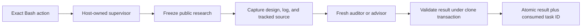

# Design and PR gates

## TL;DR

Design and publication gates check edit authority, pull request descriptions and size, and author review.

For contributor steps, see [design registration](../CONTRIBUTING.md#pull-request-descriptions). Paths in code spans are relative to the plugin root.

## Design documents

Policy: `boxlite-design-doc`; commands: [Contributing](../CONTRIBUTING.md#pull-request-descriptions); outline: [design issue template](../../../.github/ISSUE_TEMPLATE/design.md).

`scripts/design-doc.sh` delegates provider reads and binding to `.agents/lib/design-doc.sh`.

| Record in worktree Git directory | Binding / validation |
| --- | --- |
| `agent-tooling-design-doc.json` | Canonical root, branch/detached HEAD, readable nonempty provider content, leading TL;DR under 40 words. |
| `agent-tooling-design-audit.json` | Root, branch, URL, live-content SHA-256; automatic results require worker provenance, while human overrules retain their binding. |
| `agent-tooling-design-advice.json` | Fresh advice bound to the verdict and its worker task ID, with advisor provenance; overrules need none. |
| `agent-tooling-design-worker.json` | Owned task ID, exact snapshot, review and collection deadlines, consumed or aborted status. |

A leftover `agent-tooling-design-research.json`, or an audit record without loop fields, fails closed and names the file to remove.

- `.agents/lib/verdict-audit-state.sh` supplies safe reads/replacement; failed reads retain no success cache.
- Notion child blocks fail closed; native block structure prevents literal text forging headings; design length has no total-word cap.
- Missing/stale authority names the auditor route; fresh PASS also waits for advice; changed content requires review again.
- Standalone `verdict` and `advice` submissions exit 2 with a diagnostic on stderr and cannot authorize edits.
- Critical/high gaps FAIL; low/nit gaps remain advisory; every round checks the complete design skill and outline.

The research log stays out of the design, which is for human reviewers:

| Part | Behavior |
| --- | --- |
| Store | `design-doc.sh log` stores stdin (≤32,000 characters) as `{id, log}` in `agent-tooling-design-log/<sha256 of design ID>.json` under the clone's common directory (Git 2.31+). Normalized IDs (GitHub `owner/repo#N` lowercase, Linear uppercase, Notion lowercase without dashes) let URL spellings, worktrees, and re-registration share one log; removing a worktree keeps it. |
| Write | Empty input tombstones the log; records are replaced atomically, never removed, and read only as bounded regular files; a failed write keeps the stored log. |
| Hash | With no log ever stored, the bound SHA-256 is the provider body's; otherwise it hashes `agent-tooling-design-log-v1`, the body hash, and the log hash, one per line, so any log change needs a new audit in every bound worktree. |
| Show | `design-doc.sh show` renders one verified capture and appends `## Research log (local)`, the log's `sha256:` line, and the log; advice anchors resolve against that text. The log is never published; deleting the clone loses it. |
| Template | The design and [issue template](../../../.github/ISSUE_TEMPLATE/design.md) stay tool-free; the skill and audit prompts own the research protocol. |

### Audit rule ownership

Specs own input/output; `design-criteria.md` owns steps/entry format (2048-byte cap); `design-outline.md` owns whole-design checks; tasks own deadlines and untrusted-record framing.

| Section | Rule | Severity |
| --- | --- | --- |
| How it works | Opens with a one-line overview and a concrete example before the mechanism. | Missing overview or example first: high; other readability gaps: low |
| Related work | Opens with sourced best practice and stance, or evidence that none is established; one method table marks the chosen row Pick; cited Lessons close it. | Missing best-practice line or column: high |
| Projects column | Lists every eligible researched project under its cited methods; the auditor checks it against the log and sources. | Missing project or wrong grouping: high |

Mechanism and trade-off gaps keep their usual severity.

Design auditors, advisors, and commit or push auditors read the full design and log. Use public evidence or approval that covers every recipient.

In Notion, place the Markdown table in a top-level code block.

`probe-privacy.md` repeats deliberately in both specs; privacy hooks detect addresses/key requests, with address-only WebSearch checks.

Expansion, encoding, file-backed payloads, and Codex-hosted WebSearch bypass the heuristic; [probe policy](../.agents/prompts/audit/probe-privacy.md) remains mandatory.

### Design advice

Each live PASS/FAIL needs fresh advice after required stop/reflection handling: ≤5 single-line items, ≤500 characters each, `Why:` evidence before `Try:`.

Reject severity labels/unresolved local anchors; outside evidence remains unchecked; advice never mutates verdicts or enters `prior_findings`.

### Design audit loop

`.agents/lib/design-audit.jq` counts FAILs per root/branch across rebinding; PASS, overrule, or redesign resets the count.

`.agents/lib/audit-loop.jq` classifies the design and commit/push audit loops from their last two FAIL rounds ([design #563](https://github.com/boxlite-ai/agent-tooling/issues/563)).
The design gate and the commit/push checkpoint share it, so a loop that still shrinks waits for a human only at the limits in the table below.

| Class | Signal |
| --- | --- |
| `converging` | The latest FAIL left fewer blocking findings than the FAIL before it. |
| `stalled` | Not fewer, and a finding repeated. |
| `churning` | Not fewer, and every finding is new. |
| `infra` | The last two rounds ended in ERROR. |
| `none` | Fewer than two comparable rounds. |

A design finding repeats when its exact line returns; a history gate counts any registry ID that is still open.

| Condition / choice | Result |
| --- | --- |
| Edited content, same URL | Carry last FAIL's findings into the next task. |
| Converging FAIL: fewer blocking findings than the previous FAIL | Require reflection matching `.agents/lib/audit-reflection-contract.jq`, then audit again without a question. |
| Non-converging FAIL from the second on, eighth FAIL, or FAIL after reflection choice | Stop as INCOMPLETE and ask for a human decision. |
| Redesign | Reset count; failed content cannot be audited again. |
| Reflect again | Require reflection, then permit one more audit. |
| Overrule | Record `OVERRIDDEN`; retained `overruled:` findings are not re-raised. |
| No answer after five minutes | Keep edits blocked. |

The prompt hook records the human's first-line `design-decision: <request-id> <choice> <reason>` after checking the current request.

Neither design agent has a force-pass card; they gate edits, not turn completion or commits.

### Design conformance

Commit/push criteria compare the diff with authenticated `design-doc.sh show` output; they do not repeat design auditing.

- Linear/Notion reads need no browser login; `show [repo-root]` supports writable scratch with authoritative target binding.
- Substantive project documentation remains required for every PR; reviewers assess quality, and the design gate does not inspect documentation diffs.

### Editor scope

`.agents/lib/edit-scope.sh` exempts only targets outside every worktree/Git directory at both named and symlink-resolved locations.

- A directory without `.git` counts as outside; relative cwd, `~`, dot segments, dangling links, or unparseable targets retain the gate.
- Shell commands, other clients, and arbitrary MCP writers remain outside this hook; workflow design requirements still apply.
- Shell execution retains host permissions and independent Git/PR checks; no research-command allowlist applies.

#### Auditor report writes

The design gate allows a native commit/push or verdict auditor to save its assigned report through `Write` or a single-file add/update patch.

- `.agents/lib/audit-report-scope.sh` checks the repository, session, worker, open attempt, and current prompt epoch or verdict request before allowing the exact report path.
- Aliases, links, special files, other reports, and unrelated agents still require design authority, as do deletes, moves, and mixed patches.
- The synchronous deadline Start publishes ownership through `auditor-control.sh publish-start`; asynchronous `monitor-start` only observes that ownership.
- The deadline still ends investigation, and Stop validates and records the report as PASS, FAIL, or an execution error.

### Result ownership

Run the exact action printed by the edit gate:

```sh
bash "/absolute/installed/plugin/scripts/design-doc.sh" run
```

The host Bash hook derives the role and launches a fresh CLI; the command itself only reports status.
The hook distinguishes executable runner commands from literal arguments and quoted examples using the shared shell scanner.
Only the exact canonical action launches a worker; prefixes, suffixes, compound execution, and evaluated runner payloads are denied.

The scanner callback flushes the final word, classifies executable position, marks shell-consumed heredocs, and clears command arrays.
Recursive scans retain a detected denial; quoted data passed to readers or printers remains inert.
Command recognition preserves executable fragments attached to redirections and handles command-leading control words and quoted filename fragments.

Lookup-only command flags and Bash syntax checks stay inert; evaluated env splitting and shell options with operands are inspected.

Missing, invalid, or mismatched registration fails with a registration diagnostic and preserves the original record.

Source capture permits 32 MiB of current text and 64 MiB combined with committed text; overflow names the exceeded ceiling.
The 64 KiB per-blob limit, 10,000-file limit, tracked regular-file selection, and symlink protections remain enforced.
Committed blobs use groups of at most 64 Git batch requests, with validated identities, sizes, framing, and bounded output; the setup lease remains 30 seconds.

Malformed batch replies abort capture; missing, binary, and oversized blobs remain excluded, while repeated object IDs count once per tracked path.
Only private object-ID request files supply Git stdin; network operations retain null stdin.

The first run records an auditor result; the next edit requests an advisor before showing findings.
A matching human overrule retains its authority; an explicit run with complete automatic approval starts a fresh audit.



- Public `verdict` and `advice` commands exit 2; native Handback, Stop, and parent messages cannot publish.
- Automatic results require versioned provenance; advice references the exact verdict worker task.
- The v1 human key preserves provider trailing-newline normalization and absent-versus-deleted log semantics; automatic authority additionally checks an exact framed snapshot hash.
- Unproven results are retained as history and require fresh review; a fresh automatic audit revokes its earlier PASS before launch.
- One clone-wide directory lock serializes binding, log, human acceptance, and result publication across worktrees; existing atomic state helpers own replacement.

Python's standard library owns bounded streams, typed MCP messages, and Windows Job Objects; Bash/JQ retain validation and atomic state publication.
This runtime dependency avoids separate platform-specific JSON and process supervisors.

#### Worker profile

The installed `.agents/design-worker-policy.json` pins supported CLI versions and models.
Executable discovery uses fixed installation locations, including native Codex npm bundles; `PATH`, `CODEX_BIN`, and tool-call endpoint overrides cannot choose workers.
The runner hashes the CLI, interpreter, broker, policy, task rules, and generated startup inputs, rejecting replacements.

Claude uses restricted non-bare print, explicit settings, empty built-ins, and strict broker configuration, preserving host authentication.
Detected managed files, drop-ins, MCP configuration, OS policy, or nonempty remote caches require separate qualification and block the launch.
Codex disables user configuration, rules, hooks, shell, search, extensions, and delegation; a private model catalogue excludes independently registered capabilities.
Both use a neutral directory and receive no parent history.

The administrative policy can pin `executables` and `authentication` for a qualified deployment; keep credentials out of committed policy.
`offline_research: true` prohibits prefetch; the worker must report missing research coverage honestly.
Model proxy settings come from the validated user network file; public probes receive no inherited credentials or proxy configuration.

#### Broker and lifetime

The broker exposes tracked-source discovery, literal search, bounded reads, local history, and frozen research-cache reads.
It excludes untracked files, links, submodules, repository metadata, general shell, and arbitrary HTTP requests.
A clean Git object reader ignores replacements and grafts; fixed Git commands disable lazy fetches, filters, hooks, and pagers.

Anonymous public design content authorizes exact prefetch URLs and fixed index queries before private evidence is read.
Private providers get no outbound plan without separate approval; workers cannot submit new queries or locators after seeing private material.
Transport requires public DNS answers, pinned IPv4 HTTPS peers, certificate verification, no redirects, and bounded streams.

An outer supervisor independently caps setup at 30 seconds; review uses `DESIGN_AUDITOR_TIMEOUT`, default 900, maximum 9,999 seconds.
Collection and cleanup each allow at most 30 seconds; the dedicated host hook allows 10,120 seconds.
The broker rejects research at the cutoff, while valid collection reports retain the owned deadline marker.

POSIX workers and brokers have separate in-group controllers; supervisor EOF or leader death terminates remaining group members.
Windows starts suspended workers inside kill-on-close Job Objects; broker descendants must remain inside the supervisor job.
Interruption, malformed output, stale content, duplicate delivery, and an accepted human decision cannot grant new authority.

Platform and authentication qualification must be recorded before release; fixture coverage does not establish native-host compatibility.
Fresh server-delivered policy and managed deployments need effective-policy qualification beyond these local source checks.
These are local workflow checks; same-user state tampering and forged private hook invocations remain outside the boundary.

### Design operations

Public commands clear reserved publication inputs; a reflection preserves the recorded worker proof.

| Design operation | Contract |
| --- | --- |
| Audit | Exact `design-doc.sh run` Bash action; the hook assigns a fresh auditor. |
| Advice | The same action assigns the advisor required by the current verdict. |
| Repeated FAIL | Submit `design-doc.sh reflect` or answer first-line `design-decision: <request-id> <Redesign\|Reflect again\|Overrule> <reason>`. |
| Codex question | Exact async payload/request-ID title; matching late answers count, silence blocks, changed design/history needs new request. |
| Provider auth | GitHub `gh`; Notion `NOTION_TOKEN`; Linear `LINEAR_API_KEY`; environment only. |
| Binding/content | Re-register after branch changes; Notion text must use top-level blocks. |

## PR description structure

`.agents/lib/pr-description.sh` checks create/edit/ready operations, drafts included, before acknowledgment handling.

| Requirement | Contract |
| --- | --- |
| Design link | Rendered anchor outside code exactly targets the registered canonical URL. |
| Preserved body | Fetch published text and match branch/HEAD, including metadata-only edits. |
| Explanation | Rendered level-two **How it works** has content before the next peer/higher heading. |
| Accepted content | Prose, lists, tables, diagrams; any independently qualifying matching section suffices. |
| Rejected content | Nested headings alone, quotes, comments, example headings, or placeholder-only/mixed placeholders. |
| Render bounds | 20 seconds, 64 KiB; failure blocks publication without consuming acknowledgment. |

Hidden source URLs do not count; direct API/browser writes bypass this CLI boundary; example accuracy and relevance remain human review responsibilities.

### PR body files

Run the launcher from a Claude Code or Codex shell in the PR checkout. Use the plugin's installed path in place of `/path/to/plugin`.

```sh
bash /path/to/plugin/scripts/gh-pr.sh create --draft --title 'fix: keep approved text' --body-file ./pr.md
bash /path/to/plugin/scripts/gh-pr.sh edit 42 --title 'fix: keep approved text' --body-file ./pr.md
```

Omit `--draft` for a non-draft create. Put metadata and target flags after the title and body file.

| Boundary | Contract |
| --- | --- |
| Input | One regular UTF-8 file, up to 24 KiB. Reject symlinks, special files, stdin, and NUL bytes. |
| Checks | Apply the same writing, privacy, design, size, target, and review rules as inline PR text. |
| Review | When required, match the SHA-256 shown in the diagnostic to the reviewed file. A different body or session needs a fresh acknowledgment. |
| Publication | Pass the checked bytes to `gh` through stdin, including trailing newlines. |

Use a direct launcher call with the host's session environment. Direct `gh` commands require inline bodies.

## PR size and stacks

`.agents/lib/pr-target.sh` resolves one target for size, design, and review; `.agents/lib/pr-size.sh`/`.agents/lib/pr-size.jq` measure published GitHub comparisons.

| Target input | Contract |
| --- | --- |
| Checkout | `workdir` → tool `cwd` → event `cwd` → process cwd; explicit invalid directories deny. |
| Review state | Without directory metadata, review state lives under `CLAUDE_PROJECT_DIR`. |
| Alternate checkout | Literal `env -C /absolute/checkout` / supported `--chdir`; reject relative, dynamic, repeated, or other overrides. |
| Repository | Literal `--repo`/`-R`, `[HOST/]OWNER/REPO`, before/after subcommand. |
| Creation | Published head must match local HEAD; resolve fork network without guessing repository name. |
| Base | Explicit `--base`/`-B`, head branch `gh-merge-base`, then repository default. |
| Head | `--head`/`-H`, including `owner:branch`; separated, equals, attached short forms. |
| Edit/ready | Resolve PR refs, repository, number, body; omitted selectors preserve gh branch tracking. |
| Unsupported | Duplicate/dynamic targets, URL selectors, base-changing edits, environment overrides. |

Size/review authority binds host, repository, refs, commits, PR identity, and session where applicable; targets recheck before publication.

For example, 612 code additions trigger **Bypass limit** or **Split PR**. A bypass binds that diff without requiring justification.

Creation becoming an existing PR changes identity; later GitHub writes cannot be atomic with the hook.

| Measurement | Rule |
| --- | --- |
| Count | Code additions, including comments/blank lines, configuration, generated files, unknown extensions, MDX, and build/dependency manifests. |
| Exclude | `*.spec.ts`, `*_test.go`, `tests/`, recognized prose, assets/data/logs, lockfiles; classifier owns exact list. |
| Renames | Test destinations excluded; otherwise either code name counts; repository attributes cannot override classification. |
| Completeness | Validate names/statistics; ≥300 returned files deny because GitHub may truncate even prose-only comparisons. |
| Decision | Bypass needs no reason, binds exact diff; split persists on retry; changed HEAD invalidates bypass, even for excluded files. |

Git pushes, API/browser writes, and stack commands bypass per-PR size checking; other publication checks still apply.

[Workflow](../guidance/workflow.md#pr-size-and-decomposition) owns decomposition; [tracking template](../.agents/prompts/pr/split-pr-tracking-issue.md) owns the plan.

Publish each layer through guarded commands, then `gh stack link` verified PR URLs with matching bases; issue creation has no gate.

## Author review acknowledgment

Trusted base/default-branch `.github/workflows/author-review.yml` invokes `scripts/pr-author-review.sh` → `.agents/lib/pr-author-review.sh` → `pr_author_review_run` independently of local hooks.

| Live state | Result |
| --- | --- |
| No current acknowledgment | Pending; convert ready PR to draft and verify mutation identity/state. |
| Author's new, unedited `/reviewed <full-head-SHA>` comment | Success; preserve draft until manually marked ready. |
| Changed head or edited/deleted sole acknowledgment | Pending/draft; fresh comment required. |
| Another open PR shares head | Pending/draft; distinct commit required. |
| API/malformed state or 1000-comment/PR bound | Pending where writable; handler error. |
| Closed PR / ordinary issue | No write. |
| Merge queue temporary commit | Carry forward required PR-admission status; no new acknowledgment. |

- Subscribe to PR opened/reopened/synchronize/ready/closed and comment created/edited/deleted; serialize per PR without canceling active runs, five-minute job limit.
- Recompute live state for human comments, including `/recheck-author-review`; ignore new bot comments, repair edited/deleted instruction comments idempotently.
- Revoke success before scanning; refetch matching comments, retry head races at most three times, and reject edited comments/bot substitutes.
- One bot prompt uses the shared review question and writing/privacy checks; the comment is the record, with no separate database/token/App.
- Require **Author reviewed the PR** from GitHub Actions in branch rules and queue admission; job name **Update author review status** cannot substitute.
- Exit 0 means acknowledged/irrelevant, 1 awaiting acknowledgment, 2 error; failed writes cannot revoke remote success and need investigation.
- Forks follow the same rules; SHA acknowledgment asserts review, never proves reading/description quality, and survives body edits; maintainer approval remains separate.
