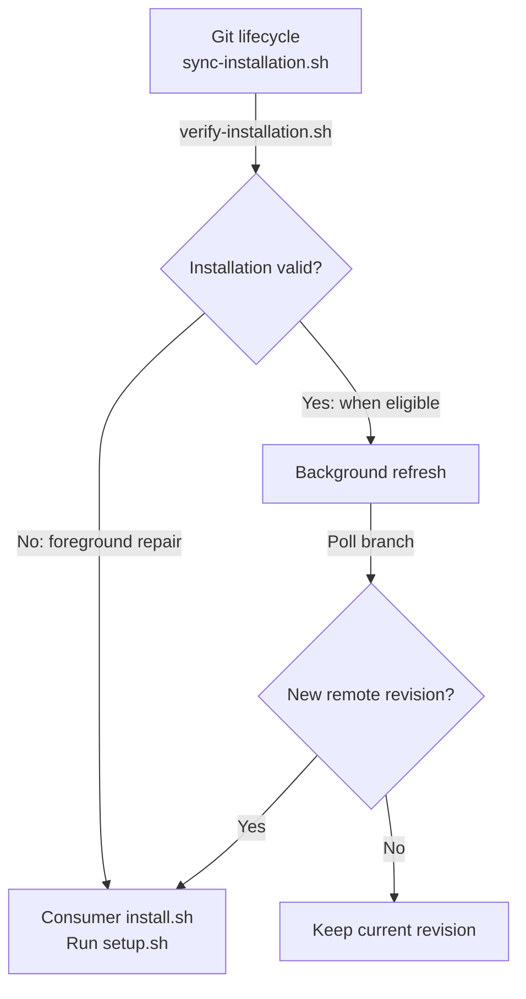

## TL;DR

These commands manage consumer installation, design registration, audit history, timed confirmations, and recovery for unattended Claude runs.

## Running commands

Use `bash <plugin-root>/scripts/<script>`; `<plugin-root>` is the parent of
`scripts/`. Commands without a repository argument generally use the current
checkout. Consumer installation starts with `./.agent-tooling/install.sh`;
the [bootstrap templates](../../../templates/) supply that entry point.

Dependencies vary by command: Bash, Git, `jq`, and Perl cover shared operations;
provider access and recovery additionally use `gh`, `curl`, or `claude`.
Keep provider credentials in environment variables.

## How it works

The scripts provide command-line boundaries around shared libraries or coordinate
installation. For example, a checkout triggers this maintenance path:



Refresh honors holds, interval checks, and a lock.

- Lifecycle-triggered installs defer committed guidance edits.
- Explicit installation updates those instructions; `setup.sh` validates the profile and configures hooks.
- Verification stays local and works offline.

Design, audit-history, and confirmation commands are separate entry points. Their
wrappers validate arguments and dependencies, then call libraries under
[`../.agents/lib/`](../.agents/lib/); the libraries own provider reads and state transitions.

`design-doc.sh show [repo-root]` reads the target's bound design without changing the
working directory. Reviewers can run it from writable scratch when the repository is
read-only; omitting the argument keeps the current-checkout behavior.

## Installation and guidance

| Script / arguments | Responsibility and effects |
| --- | --- |
| [validate-profile.sh](validate-profile.sh) `<repository-root>` | Validate the consumer profile, origin identity, host activation declarations, and required tools; reject invalid setup. |
| [setup.sh](setup.sh) `[repo-root]` | Validate the profile, synchronize instructions, and configure worktree-local Git hooks. The installer owns revision adoption. |
| [verify-installation.sh](verify-installation.sh) `[repo-root]` | Check the recorded revision, hold, cache, and hook path locally; report stale refresh locks without removing them. |
| [sync-installation.sh](sync-installation.sh) | Git lifecycle entry point: repair broken adoption in the foreground, otherwise schedule a throttled background refresh. Failures do not block lifecycle events. |
| [install.sh](install.sh) | Adopt a validated revision; the consumer installer delegates here after initial setup. |
| [claude-plugin-bootstrap.sh](claude-plugin-bootstrap.sh), [codex-plugin-bootstrap.sh](codex-plugin-bootstrap.sh) | Shared host startup implementations selected by consumer loaders; check releases, reconcile the current host, and report reload requirements. |
| [refresh-installation.sh](refresh-installation.sh) `[--if-due] [repo-root]` | Serialize refresh and adoption. `--if-due` also honors refresh opt-out and the polling interval. |
| [sync-guidance.sh](sync-guidance.sh) `[--check\|--check-current\|--force] [repo-root]` | Splice canonical workflow into consumer instructions. `--check` validates integrity; `--check-current` also rejects stale content; `--force` permits updating modified instruction files. |
| [check-writing-ownership.sh](check-writing-ownership.sh) `[repo-root]` | Check generated guidance and scan repository Markdown for copied rules owned by `boxlite-writing`. |

Lifecycle-triggered installs defer instruction edits.

- Run the consumer installer explicitly to update committed guidance.
- Lifecycle events attempt background refresh at most once every 15 minutes, sharing the stamp with session startups.
- `AGENT_TOOLING_REFRESH=0` disables automatic checks and `AGENT_TOOLING_REFRESH_MINUTES` changes the interval.
- Failed network attempts back off too; invalid profiles fail.
- A busy refresh skips without breaking its lock.

Network commands have 30-second limits within a 30-second refresh or 120-second host phase.

- `AGENT_TOOLING_COMMAND_TIMEOUT_SECONDS` can shorten each command's limit to 1–30 seconds.
- The standalone first-install fallback still relies on its caller's deadline.
- Native CLI failures are visible; an updated repository and a host installation are separate transactions.

## Installation runtime

### Consumer to tooling

Consumers float on `tooling.ref`, run recorded `.git/agent-tooling/current`, and access network only through bootstrap/refresh; `.agent-tooling/hold` freezes adoption at a valid lowercase full SHA.

`.git/agent-tooling/.refresh.lock` serializes refresh; busy skips; hour-old abandoned locks warn through verification without automatic removal.

### Lifecycle environment

`.agents/lib/git-environment.sh` clears repository-local Git variables and `GIT_NAMESPACE` after capturing consumer root, before sync/refresh enters it.

Discovery/cleanup failure prevents installation; lifecycle sync stays nonblocking; chained hooks retain parent environment, global Git/transport settings remain available.

### Offline installation repair

`templates/install.sh` validates recorded cache under installation lock, runs revision check/setup, then verifier; invalid cache/profile denies.

Repair restores worktree hooks without changing adoption/history/check timestamp; host bootstraps suppress initial probes but surface repair/refresh failures.

### Linked-worktree plugin repair

Claude project update can leave the current linked-worktree record stale; bootstrap uninstalls with `--keep-data`, reinstalls, and restores tracked settings byte-for-byte.

Restoration is armed before uninstall; persistent staleness/error keeps session blocked; restoration failure retains/names backup.

### Startup updates

Consumer templates select host implementation by recorded SHA; installer delegates to `scripts/install.sh`, with standalone empty-cache fallback.

| Owner | Contract |
| --- | --- |
| Released templates | Migration requires tooling 0.1.35 and all three loaders; automatic runs never overwrite tracked files. |
| `.agents/lib/plugin-bootstrap.sh` | Shared release/adopted-runtime lookup; initialize failure state, refresh, then transfer original input to adopted implementation. |
| Host reconciliation | Reconcile equal-old/ahead versions; opt-out mismatch needs explicit repair; Claude `--check` reads session state only. |
| `scripts/refresh-installation.sh --if-due` | Shared locked polling stamp includes failures; retain old download fallback only after profile/install validation. |
| `.agents/lib/tooling-command.sh` | Process-group TERM/KILL/reap; 30-second poll/adoption, 120-second host reconciliation including repair. |

Shell owners release locks on EXIT/INT/TERM; SIGKILL may prevent cleanup; no hot replacement of loaded sessions or automatic stale-lock recovery is claimed.

## Release maintenance

| Change | Required action |
| --- | --- |
| Release | Bump generic/Claude/Codex manifests and both version fields in Claude/Copilot marketplaces; Codex marketplace follows `main`. |
| Auditor task/dossier format | Bump version so stale sessions request reload instead of receiving incompatible tasks. |
| Host packaging | Run parity, including symlink-free copies; install/reinstall using real CLI in empty isolated Codex home, checking fresh `skills/list` and `hooks/list`. |
| Consumer adoption | Run `.agent-tooling/install.sh`, refresh host plugin, then reload/start a new task. |
| Verification | Separately check recorded revision, worktree hook path, managed guidance, and installed version; preserve holds/unrelated edits. |

Use [one-time migration instructions](../../../README.md#migrate-existing-consumers-once) for adopted-package loaders; installers never rewrite tracked loaders.

| Older installation | Migration caution |
| --- | --- |
| 0.1.29–0.1.34 | Refresh both runtime/plugin for size, API, research, summary, skill discovery, and declared-host routing. |
| Code begun under 0.1.30 | Attempt an editor edit before next commit/push to trigger missing design review; merged work remains accepted risk. |
| Before 0.1.35 | Migrate all three consumer loaders once; preserve customizations/held releases. |
| Markerless Git wiring | Retain launcher/PID contract; see [Git gates](../.githooks/README.md#git-gates). |
| Earlier design verdicts | Legacy record/`research` alias remain readable; PASS now needs fresh advice; refresh/reload, including displayed async cards. |
| Review/retry updates | Refresh whole plugin and start a new session so prompts, Git gates, and callbacks agree. |
| Before 0.1.50 | Auditors cannot read the commit/push claim-check pointer ([#407](https://github.com/boxlite-ai/agent-tooling/issues/407)); refresh the host plugin, then reload. |
| Before 0.1.51 | Designs with an inline research log: store it with `design-doc.sh log` and remove it before the next audit, which otherwise reports it as high ([#388](https://github.com/boxlite-ai/agent-tooling/issues/388)); refresh/reload. |

Check Claude installation by exact `projectPath`; updating one linked worktree can leave another stale.

Transcript discovery and runner contracts: [audit configuration](../.agents/hooks/audit/README.md), [proof/routing](../.agents/hooks/audit/architecture.md#audit-producers), [review criteria](../.agents/hooks/audit/architecture.md#commitpush-review-criteria).

`full-transcript` fixtures prove handoff/access, not live model behavior; verify native hosts/platforms separately after adoption.

## Design, review, and audit history

| Script / arguments | Responsibility and effects |
| --- | --- |
| [design-doc.sh](design-doc.sh) `register <URL>` (alias `bind`), `check`, `verdict` (alias `research`), `reflect`, or `show` | Fetch and validate a design; bind it to the current worktree/branch, recheck the existing binding, record the design auditor's stdin verdict for the live content, store the stdin reflection a later audit waits for, or recheck it and print its content. |
| [api-compatibility.sh](api-compatibility.sh) `inspect\|inspect-push\|check\|push [repo-root] [base-ref]` | Check `*openapi*.yaml` changes, require user confirmation to skip breaking/default enforcement, and export per-file request-audit evidence; see [commands](api-compatibility.md). |
| [pr-author-review.sh](pr-author-review.sh) `<github-event.json>` | CI publisher: update the author-review check and prompt, and return an unacknowledged PR to draft. Exit 0: acknowledged/irrelevant; 1: awaiting acknowledgment; 2: API/validation error. |
| [audit-reflection.sh](audit-reflection.sh) `prepare\|record\|status\|submit\|checkpoint STATE` | Read bounded request JSON; persist audit transitions or check the Git retry decision, returning cycle JSON on stdout. |
| [audit-reflection-gate.sh](audit-reflection-gate.sh) `CONTEXT OPERATION [ATTEMPT_ID]` | Adapt audit history to scoped gates: validate context, snapshot evidence, and reconcile outcomes; payload JSON arrives on stdin. |
| [validate-audit-dossier.sh](validate-audit-dossier.sh) `verdict\|commit\|push HISTORY [DOSSIER]` | Read-only candidate validation; `-` means no history or dossier on stdin; writes no audit state or approval. |
| [read-verdict-index.sh](read-verdict-index.sh) `REPO_ROOT SESSION_ID TRANSCRIPT` | Read-only checkpoint lookup for a resolved source. Exit 0 prints a tentative offset, 1 means no usable hint, and 2 means invocation or setup failed. |

Before delivery, run the validator with the task's immutable history input and candidate.

- It checks shape, captured bindings, coverage, dispositions, and reflection through the parent's shared rules.
- Correct errors and rerun within the audit deadline.
- Success emits `{"valid":true,"scope":"history"}`; without history it reports `scope:shape`.
- The parent still checks live state and controls acceptance.
- Exit codes: 0 valid, 1 invalid candidate/history, 2 usage, dependency, or input-read failure.
- Reads reject NUL and unsafe file types; limits are 1 MiB for dossiers, 10 MiB for history, and five seconds for stdin.
- No network or Git operation is needed.

From a consumer checkout, `bash <plugin-root>/scripts/design-doc.sh check`
revalidates its registered design; `show` also prints it, which is how auditors
read Linear and Notion designs without a browser login. Registration and provider authentication are
documented in [Contributing](../CONTRIBUTING.md#pull-request-descriptions).

Native auditors use the [audit-history procedure](../.agents/prompts/audit/git-audit-history.md).
History CLI context is JSON containing `repo_root`, `session`, `epoch`, `branch`,
and `gate`; use the prescribed operations instead of editing state files.
See [state contracts](../.agents/hooks/audit/state.md#state-files) and the
[author-review workflow](../../../.github/workflows/author-review.yml).

## Confirmations and recovery

| Script / arguments | Responsibility and effects |
| --- | --- |
| [timed-user-prompt.sh](timed-user-prompt.sh) `request\|status\|question\|respond\|renew\|consume\|fallback STATE SPEC_OR_ID [HUMAN_TEXT]` | Persist confirmation deadlines, exact human responses, consumption, and expiry; renewal requires the user's explicit instruction. |
| [claude-with-timed-prompts.sh](claude-with-timed-prompts.sh) `[claude args...]` | Launch Claude with this plugin; configure native question timeout for supported local sessions and disable Remote Control there. |
| [continue-timed-prompts.sh](continue-timed-prompts.sh) | Called by the Stop gate with hook JSON on stdin; emit a continuation for pending confirmations or their timeout fallback. |
| [resume-on-network-error.sh](resume-on-network-error.sh) `[--max-restarts N] [--max-wait SECONDS] [--probe-url URL] [--] <prompt> [claude args...]` | Supervise `claude -p`, retry eligible API failures within budgets, and print final result JSON. |

Git preparation checks the three-failure decision under the history lock.

- `checkpoint` checks the same decision without creating an attempt; it returns exit 2 while waiting or stopped.
- Five-minute expiry permits one reflected retry, preserving failed outcomes.
- See [retry choices](../.agents/hooks/audit/README.md#commitpush-retry-choices).

The recovery wrapper needs [record-api-failure.sh](../.agents/hooks/record-api-failure.sh) and a matching `CLAUDE_PROJECT_DIR`.

- Defaults allow 50 restarts and six hours of total waiting; unknown failure kinds get a smaller budget.
- Run it with `--help` for exit codes.
- Interactive recovery uses a separate [StopFailure hook](../.agents/hooks/resume-after-api-failure.sh).

See [timed confirmations](../docs/timed-confirmations.md#timed-confirmations) for supported
host modes and response rules.

## Tests

Run suites from the repository root, for example:

```sh
bash plugins/boxlite-agent-tooling/scripts/design-doc.test.sh
bash plugins/boxlite-agent-tooling/scripts/sync-guidance.test.sh
bash plugins/boxlite-agent-tooling/scripts/refresh-installation.test.sh
make test:bootstrap
```

Most commands have adjacent `*.test.sh` suites.

- Installation also uses [template tests](../../../templates/install.test.sh) and [Git lifecycle tests](../.githooks/lifecycle.test.sh).
- `audit-history-*.test.sh`, [the audit reconciliation suite](audit-reconciliation.test.sh), and `audit-reflection-*.test.sh` cover shared history. `claude-timed-*.test.sh` cover launcher and question integration.
- `fixtures/` contains test helpers, not operator commands.
